## 5.5 Work Breakdown Structure (updated after the final task distribution)

Changes from the first version: FPA and COCOMO moved from Yağız to Mert; owners of analysis models, class and state diagrams, slides, video, repository and deployment aligned with the final distribution.

```plantuml
@startwbs
* CampusSlot Project
** 1.0 Project Management
*** 1.1 Planning and Control
**** 1.1.1 Project plan, WBS, PERT, Gantt (Mert)
**** 1.1.2 Sprint planning, reviews, retrospectives (Mert)
**** 1.1.3 Risk and status tracking (Mert)
*** 1.2 Estimation and Value
**** 1.2.1 FPA and COCOMO estimation (Mert)
**** 1.2.2 Feasibility analysis, 5.10 (Mert)
**** 1.2.3 Value and benefit analysis, cost-benefit Excel, 5.11 (Mert)
*** 1.3 Repository and Tools
**** 1.3.1 GitHub repo and project skeleton (Batuhan)
**** 1.3.2 Group registration, shared folder, report skeleton, task board (Mert)
** 2.0 Analysis
*** 2.1 Fact-Finding
**** 2.1.1 Survey, two interviews, observation, document review (Zeynep)
**** 2.1.2 Literature review, 5.3 (Arzum)
*** 2.2 Requirements
**** 2.2.1 FR and NFR specification, user stories (Zeynep)
**** 2.2.2 Use case descriptions UC-01 to UC-10 (Zeynep)
*** 2.3 Analysis Models
**** 2.3.1 Fishbone and DFD Context, Level 0, Level 1 (Zeynep)
**** 2.3.2 Use case diagram and decision table (Görkem)
**** 2.3.3 Activity diagrams (Arzum)
** 3.0 Design
*** 3.1 Architecture
**** 3.1.1 Architecture, component and deployment diagrams (Batuhan)
**** 3.1.2 REST API contract, security and KVKK (Batuhan)
*** 3.2 Data and Class Design
**** 3.2.1 Class diagram and ERD (Erol)
**** 3.2.2 Prisma schema and migrations (Erol)
*** 3.3 UX Design
**** 3.3.1 Wireframes (Arzum)
**** 3.3.2 Screen designs and style guide (Arzum)
*** 3.4 Dynamic Design
**** 3.4.1 Sequence and state machine diagrams (Enes)
** 4.0 Implementation
*** 4.1 Backend
**** 4.1.1 Scaffold, auth and RBAC, F1 (Erol)
**** 4.1.2 Resource and availability APIs, F2, F8 (Erol)
**** 4.1.3 Reservation engine R1-R6, notifications, F3, F4, F7 (Erol)
**** 4.1.4 QR check-in, no-show scheduler, penalties, F5, F6 (Erol)
*** 4.2 Frontend
**** 4.2.1 Scaffold, auth, search and calendar pages (Enes)
**** 4.2.2 Reservation, My Reservations, QR scan pages (Enes)
**** 4.2.3 Admin panel and reports (Enes)
*** 4.3 Integration
**** 4.3.1 Frontend-backend integration and bug fixing (Enes, Erol)
**** 4.3.2 Code freeze, 1 Dec (Mert)
** 5.0 Testing
*** 5.1 Test Planning
**** 5.1.1 Test plan and test cases TC-01... (Görkem)
*** 5.2 Test Execution
**** 5.2.1 Backend API unit and integration tests (Görkem)
**** 5.2.2 System, E2E and regression tests (Görkem)
*** 5.3 Test Reporting
**** 5.3.1 Test results and screenshots for 5.12 (Görkem)
** 6.0 Delivery
*** 6.1 Report
**** 6.1.1 Drafting of report sections 5.2-5.9 (section authors)
**** 6.1.2 Report integration and single PDF, 4 Dec (Mert)
*** 6.2 Presentation
**** 6.2.1 Slide template and 2-minute video (Arzum)
**** 6.2.2 Merging slides, content from all members (Mert)
*** 6.3 Submission
**** 6.3.1 Deployment and demo backup (Görkem)
**** 6.3.2 GitHub link, running app, final check (Mert)
@endwbs
```

| WBS | Work package | Owner | PERT ID |
|---|---|---|---|
| 1.1.1 | Project plan, WBS, PERT, Gantt | Mert | A |
| 1.1.2 / 1.1.3 | Sprint ceremonies, risk and status tracking | Mert | ongoing |
| 1.2.1 | FPA and COCOMO | **Mert** (was Yağız) | V |
| 1.2.2 / 1.2.3 | Feasibility (5.10), value and cost-benefit (5.11) | Mert | U |
| 1.3.1 | GitHub repo and project skeleton | Batuhan | A |
| 1.3.2 | Registration, shared folder, report skeleton, board | Mert | A |
| 2.1.1 | Survey, interviews, observation, document review | Zeynep | B |
| 2.1.2 | Literature review (5.3) | Arzum | B |
| 2.2.1 / 2.2.2 | FR/NFR, user stories, UC-01…UC-10 | Zeynep | C |
| 2.3.1 | Fishbone, DFD Context / Level 0 / Level 1 | Zeynep | D |
| 2.3.2 | Use case diagram, decision table | Görkem | D |
| 2.3.3 | Activity diagrams | Arzum | D |
| 3.1.1 / 3.1.2 | Architecture, component, deployment, API, security, KVKK | Batuhan | E |
| 3.2.1 / 3.2.2 | Class diagram, ERD, Prisma schema | Erol | F |
| 3.3.1 / 3.3.2 | Wireframes, screen designs | Arzum | G |
| 3.4.1 | Sequence and state machine diagrams | Enes | D |
| 4.1.1 | Backend scaffold, auth, RBAC (F1) | Erol | H |
| 4.1.2 | Resource and availability APIs (F2, F8) | Erol | I |
| 4.1.3 | Reservation engine (F3, F4, F7) | Erol | J |
| 4.1.4 | QR check-in, scheduler, penalties (F5, F6) | Erol | K |
| 4.2.1 | Frontend scaffold, auth, search | Enes | L |
| 4.2.2 | Reservation, My Reservations, QR pages | Enes | M |
| 4.2.3 | Admin panel and reports | Enes | N |
| 4.3.1 / 4.3.2 | Integration, code freeze | Enes, Erol, Mert | P |
| 5.1.1 | Test plan, TC-xx | Görkem | O |
| 5.2.1 | Backend API tests | Görkem | Q1 |
| 5.2.2 | System, E2E, regression | Görkem | Q2 |
| 5.3.1 | Test results and screenshots (5.12) | Görkem | S |
| 6.1.1 | Report section drafting (5.2–5.9) | Section authors | T |
| 6.1.2 | Report integration, PDF | Mert | X |
| 6.2.1 / 6.2.2 | Slide template, video, slide merge | Arzum, Mert | W |
| 6.3.1 / 6.3.2 | Deployment, demo backup, final submission | Görkem, Mert | Y |

## 5.5 PERT: owner changes

The PERT table has no owner column. Only activity V (FPA and COCOMO) changes: its owner is now **Mert** instead of Yağız. The O, M, P, TE and variance values and all ES, EF, LS, LF and slack values stay the same, so the critical path (A → B → C → G → L → M → P → Q2 → W → Y, 18.00 days) is unchanged.

Workload note: V and U (5.10, 5.11) are now both Mert's. They already run in sequence (V: day 7–8, U: day 9–11) and have 5.00 days of slack each, so they do not affect the critical path. The Project Manager's critical activities (A, P, Y and the code freeze) do not overlap with V and U.
