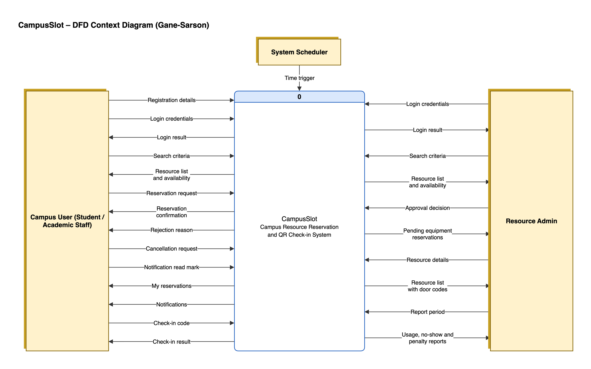
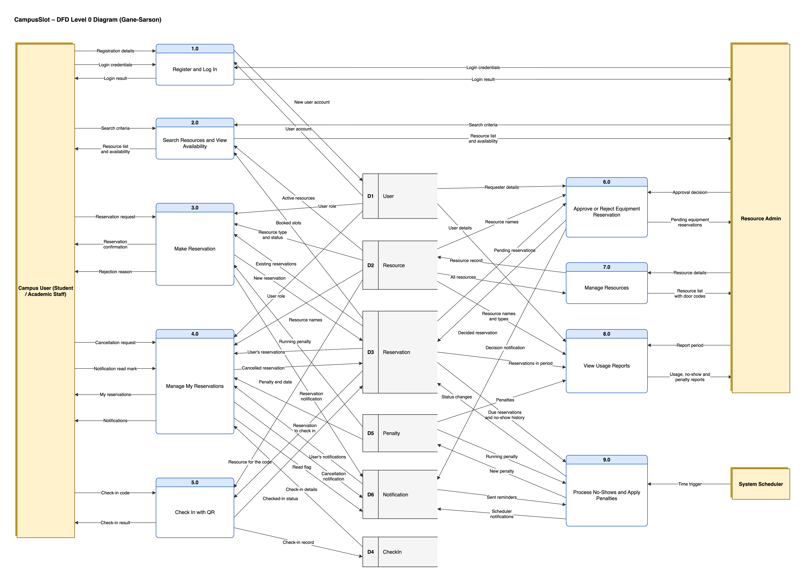
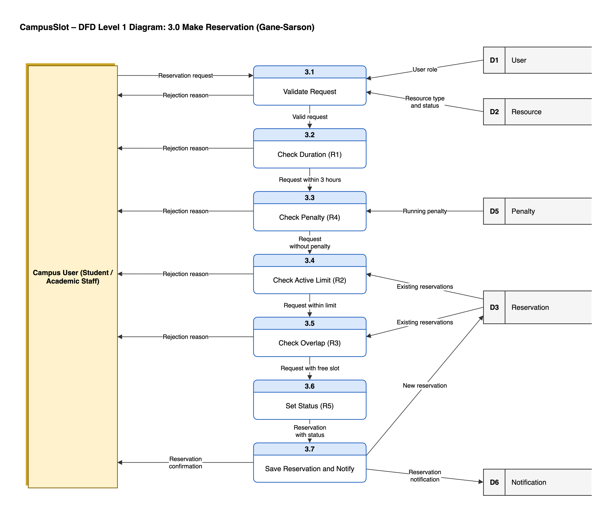

## 5.6 Analysis Models: Data Flow Diagrams (draft v1, 26 Nov 2026)

**Owner.** Yağız Asker. The DFDs were planned as part of the Business Analyst's work (Zeynep) and were handed over to Yağız on 26 Nov 2026 (HANDOFFS H46). The use case diagram and descriptions and the decision tables (Görkem), the activity diagrams (Arzum) and the user stories (Zeynep) are other parts of 5.6.

**Inputs.** The project card (actors, F1–F8, R1–R9, UC-01 to UC-10, reservation states), the functional requirements in 5.4 (FR-01 to FR-55 and the decisions D1–D4), the Prisma schema `backend/prisma/schema.prisma` (its six tables are the six data stores), the API design in 5.8 (rule chain 5.8.4.7, check-in logic 5.8.4.8, scheduler jobs 5.8.4.9), the use case descriptions in 5.6.2 and the state machine in 5.7 (T3 and T4). No survey, interview or observation result is used in this section.

**Files.** draw.io sources and PNG images in `docs/diagrams/`: `5.6_DFD-context_Yagiz`, `5.6_DFD-level0_Yagiz` and `5.6_DFD-level1_Yagiz` (each as `.drawio` and `.png`).

### 5.6.9 Data Flow Diagrams

The data flow diagrams (DFDs) show which data enters CampusSlot, where it goes inside the system, where it is stored and which data leaves the system. They complement the use case diagram (who does what) and the activity diagrams (in which order). A DFD shows no order and no decisions: a process receives data, transforms it and passes it on. The diagrams are logical. They show what the system does with the data, not how it is built, so tokens, HTTP calls and database transactions do not appear.

Three levels are drawn:

- the **context diagram** shows the whole system as one process and the data it exchanges with its external entities;
- the **Level 0 diagram** splits the system into 9 processes and 6 data stores;
- the **Level 1 diagram** explodes process 3.0 Make Reservation into the checks of R1–R5.

#### 5.6.9.1 Notation

The diagrams use the Gane-Sarson notation.

| Symbol | Drawn as | Meaning in CampusSlot |
|---|---|---|
| External entity | Rectangle with a shaded top and left edge | A person, a group or a time source outside the system that sends data to the system or receives data from it. |
| Process | Rounded rectangle; the top band holds the number, the body the name | Work that turns incoming data into outgoing data. Numbered 0 (context), 1.0–9.0 (Level 0) and 3.1–3.7 (Level 1). |
| Data store | Rectangle open on the right; the left cell holds the ID | Data kept for later use. D1–D6 are the six tables of the Prisma schema. |
| Data flow | Named arrow | Data moving between two symbols. The name is a noun phrase; the arrow head shows the direction. |

These rules were applied to all three diagrams and checked for every flow:

1. Every process has at least one incoming and one outgoing data flow.
2. Every data flow starts or ends at a process. Data never moves directly between two external entities, between an external entity and a data store, or between two data stores.
3. Every data store is written by at least one process and read by at least one process.
4. The levels are balanced: the data flows that cross the border of a process are the same on the parent diagram and on its child diagram (5.6.9.5).

#### 5.6.9.2 Context diagram

*Figure 5.6-DFD-1. Context diagram (Gane-Sarson notation).* Source: `docs/diagrams/5.6_DFD-context_Yagiz.drawio`.

The whole system is one process, 0 CampusSlot. Three external entities exchange 25 data flows with it.

- **Campus User (Student / Academic Staff)** is drawn as one entity. Students and academic staff send and receive exactly the same data: registration, search, reservation, cancellation, check-in. The only difference between them is the R2 limit (2 or 5 active reservations), and the system takes it from the role stored in D1 User, not from a different data flow. This follows the project card, where both actors derive from the common actor Campus User.
- **Resource Admin** manages the resources, decides equipment reservations and reads the reports. A Resource Admin does not make reservations or check in (decision D3).
- **System Scheduler** is drawn as an external entity, as in the use case diagram (5.6.1, UC-A3): UC-09 is started by time, not by a person. In the DFD it only sends the time trigger, every 60 seconds (5.8.4.9). The work it starts (no-shows, penalties, completion, automatic rejection, reminders) is process 9.0 inside the system.

**External entities**

| External entity | Who or what it is |
|---|---|
| Campus User (Student / Academic Staff) | Students (role STUDENT) and academic staff (role ACADEMIC_STAFF). Both send and receive the same data; only the R2 limit differs (2 or 5), which the system reads from the role stored in D1 User. |
| Resource Admin | Laboratory and administrative staff (5.2, stakeholder S3), role RESOURCE_ADMIN. Manages resources, decides EQUIPMENT reservations, reads reports. Does not reserve or check in (decision D3). |
| System Scheduler | Time source that starts the scheduled work every 60 seconds (5.8.4.9). It sends only the time trigger; the work itself is process 9.0 inside the system. |

**Data flows of the context diagram** (each request is listed next to its answer)

| No. | Data flow | From | To | Content |
|---|---|---|---|---|
| C-01 | Registration details | Campus User | 0 CampusSlot | Full name, e-mail, password, role (STUDENT or ACADEMIC_STAFF), privacy notice accepted |
| C-02 | Login credentials | Campus User | 0 CampusSlot | E-mail and password |
| C-03 | Login result | 0 CampusSlot | Campus User | The user's identity and role for the session, or the message that the e-mail or password is wrong (FR-04) |
| C-04 | Search criteria | Campus User | 0 CampusSlot | Search text, resource type, minimum capacity; resource and date for the calendar |
| C-05 | Resource list and availability | 0 CampusSlot | Campus User | Matching active resources; booked slots of one resource on one date |
| C-06 | Reservation request | Campus User | 0 CampusSlot | Resource, start time, end time, optional purpose |
| C-07 | Reservation confirmation | 0 CampusSlot | Campus User | New reservation with status CONFIRMED (ROOM, LAB) or PENDING_APPROVAL (EQUIPMENT) |
| C-08 | Rejection reason | 0 CampusSlot | Campus User | Which check failed (input, R1, R4, R2 or R3), in plain words |
| C-09 | Cancellation request | Campus User | 0 CampusSlot | One own reservation to cancel |
| C-10 | Notification read mark | Campus User | 0 CampusSlot | One own notification marked as read |
| C-11 | My reservations | 0 CampusSlot | Campus User | Own reservations with resource, status, rejection reason and check-in time; active reservations against the R2 limit; penalty end date; the answer to a cancellation (CANCELLED, or refused at or after the start time, R6) |
| C-12 | Notifications | 0 CampusSlot | Campus User | Own in-app notifications, newest first, read or unread |
| C-13 | Check-in code | Campus User | 0 CampusSlot | Scanned QR token or typed 6-digit code, with the method (QR_SCAN or MANUAL_CODE) |
| C-14 | Check-in result | 0 CampusSlot | Campus User | CHECKED_IN confirmation, or why the check-in was refused: unknown code, no reservation here, too early, too late, already checked in, not confirmed yet (5.8.4.8) |
| C-15 | Login credentials | Resource Admin | 0 CampusSlot | E-mail and password |
| C-16 | Login result | 0 CampusSlot | Resource Admin | The user's identity and role for the session, or the message that the e-mail or password is wrong (FR-04) |
| C-17 | Search criteria | Resource Admin | 0 CampusSlot | Search text, resource type, minimum capacity; resource and date for the calendar |
| C-18 | Resource list and availability | 0 CampusSlot | Resource Admin | Matching active resources; booked slots of one resource on one date |
| C-19 | Approval decision | Resource Admin | 0 CampusSlot | Approve, or reject with a reason, one pending EQUIPMENT reservation |
| C-20 | Pending equipment reservations | 0 CampusSlot | Resource Admin | PENDING_APPROVAL reservations of EQUIPMENT with requester, resource, time, purpose; the answer to a decision (done, or refused when the start time has passed, 5.7 T3 and T4) |
| C-21 | Resource details | Resource Admin | 0 CampusSlot | Name, type, location, capacity, description of a new resource; changes; deactivation |
| C-22 | Resource list with door codes | 0 CampusSlot | Resource Admin | All resources, also inactive ones, with QR token and 6-digit code |
| C-23 | Report period | Resource Admin | 0 CampusSlot | From and to dates, optional resource type |
| C-24 | Usage, no-show and penalty reports | 0 CampusSlot | Resource Admin | Occupancy and no-show rate per resource; users with no-shows; penalties |
| C-25 | Time trigger | System Scheduler | 0 CampusSlot | Start of a scheduler run, every 60 seconds |

#### 5.6.9.3 Level 0 diagram

*Figure 5.6-DFD-2. Level 0 diagram (Gane-Sarson notation).* Source: `docs/diagrams/5.6_DFD-level0_Yagiz.drawio`.

The 9 processes follow the use cases. UC-04 Cancel Reservation is part of 4.0 Manage My Reservations, because cancelling starts from the reservation list (it extends UC-10 in 5.6.1). In-app notifications are not a process of their own: processes 3.0, 4.0, 6.0 and 9.0 write them to D6 Notification, and 4.0 reads them for the user (UC-A2 in 5.6.1). Process 3.0 is exploded in the Level 1 diagram (5.6.9.4). The diagram has 65 data flows.

**Processes**

| No. | Process | Use case | What it does |
|---|---|---|---|
| 1.0 | Register and Log In | UC-01 | UC-01. Stores a new Campus User account; checks e-mail and password; starts the session with the role. FR-01 to FR-06. |
| 2.0 | Search Resources and View Availability | UC-02 | UC-02. Lists active resources by the criteria; shows booked slots of one resource on one date. FR-07 to FR-12. |
| 3.0 | Make Reservation | UC-03 | UC-03. Checks the request (input, R1, R4, R2, R3), sets the status by R5, stores the reservation and a notification. FR-13 to FR-22. Exploded in Level 1. |
| 4.0 | Manage My Reservations | UC-10, UC-04 | UC-10 with UC-04. Lists own reservations and notifications, marks a notification as read, cancels before the start time (R6). FR-23 to FR-30, FR-43. |
| 5.0 | Check In with QR | UC-05 | UC-05. Finds the resource by QR token or 6-digit code and the user's CONFIRMED reservation in the R7 window; records the check-in or says why it is refused. FR-32 to FR-37. |
| 6.0 | Approve or Reject Equipment Reservation | UC-06 | UC-06. Shows pending EQUIPMENT reservations; stores the admin's decision, which is allowed only before the start time (5.7, T3 and T4), and notifies the user (R5). FR-44 to FR-48. |
| 7.0 | Manage Resources | UC-07 | UC-07. Creates, edits and deactivates resources; generates the QR token and 6-digit code. FR-31, FR-49 to FR-51. |
| 8.0 | View Usage Reports | UC-08 | UC-08. Calculates occupancy and no-show rates, the no-show list and the penalty list for a period. FR-52 to FR-54. |
| 9.0 | Process No-Shows and Apply Penalties | UC-09 | UC-09. On each time trigger: NO_SHOW after 15 minutes (R8), 7-day penalty after 3 no-shows in 30 days (R9), COMPLETED after the end, REJECTED for undecided equipment at the start (decision D4). FR-38 to FR-42, FR-55. It also sends the J4 check-in reminders (FR-30, which 5.4 maps to UC-10), because the same time trigger starts them; they are notifications, not part of the UC-09 goal (UC-A2). |

**Data stores**

| ID | Data store (Prisma table) | Content | Written by | Read by |
|---|---|---|---|---|
| D1 | User | Accounts: full name, e-mail, password hash, role. | 1.0 | 1.0, 3.0, 4.0, 6.0, 8.0 |
| D2 | Resource | Rooms, labs and equipment: name, type, location, capacity, description, QR token, 6-digit check-in code, active flag. | 7.0 | 2.0, 3.0, 4.0, 5.0, 6.0, 7.0, 8.0 |
| D3 | Reservation | Reservations: user, resource, start, end, status (7 states), purpose, admin decision, cancellation time. | 3.0, 4.0, 5.0, 6.0, 9.0 | 2.0, 3.0, 4.0, 5.0, 6.0, 8.0, 9.0 |
| D4 | CheckIn | One check-in per reservation: time and method (QR_SCAN or MANUAL_CODE). | 5.0 | 4.0 |
| D5 | Penalty | 7-day reservation bans: user, reason, number of no-shows, start, end (R9). | 9.0 | 3.0, 4.0, 8.0, 9.0 |
| D6 | Notification | In-app notifications: user, reservation, type, message, read flag. | 3.0, 4.0, 6.0, 9.0 | 4.0, 9.0 |

**Data flows of the Level 0 diagram** (grouped by process)

| No. | Data flow | From | To | Content |
|---|---|---|---|---|
| L0-01 | Registration details | Campus User | 1.0 | Full name, e-mail, password, role (STUDENT or ACADEMIC_STAFF), privacy notice accepted |
| L0-02 | Login credentials | Campus User | 1.0 | E-mail and password |
| L0-03 | Login credentials | Resource Admin | 1.0 | E-mail and password |
| L0-04 | Login result | 1.0 | Campus User | The user's identity and role for the session, or the message that the e-mail or password is wrong (FR-04) |
| L0-05 | Login result | 1.0 | Resource Admin | The user's identity and role for the session, or the message that the e-mail or password is wrong (FR-04) |
| L0-06 | New user account | 1.0 | D1 User | Full name, e-mail, password hash, role |
| L0-07 | User account | D1 User | 1.0 | E-mail, password hash and role of the account |
| L0-08 | Search criteria | Campus User | 2.0 | Search text, resource type, minimum capacity; resource and date for the calendar |
| L0-09 | Search criteria | Resource Admin | 2.0 | Search text, resource type, minimum capacity; resource and date for the calendar |
| L0-10 | Resource list and availability | 2.0 | Campus User | Matching active resources; booked slots of one resource on one date |
| L0-11 | Resource list and availability | 2.0 | Resource Admin | Matching active resources; booked slots of one resource on one date |
| L0-12 | Active resources | D2 Resource | 2.0 | Name, type, location, capacity, description of resources with isActive = true |
| L0-13 | Booked slots | D3 Reservation | 2.0 | Start and end of PENDING_APPROVAL, CONFIRMED and CHECKED_IN reservations (decision D2) |
| L0-14 | Reservation request | Campus User | 3.0 | Resource, start time, end time, optional purpose |
| L0-15 | Reservation confirmation | 3.0 | Campus User | New reservation with status CONFIRMED (ROOM, LAB) or PENDING_APPROVAL (EQUIPMENT) |
| L0-16 | Rejection reason | 3.0 | Campus User | Which check failed (input, R1, R4, R2 or R3), in plain words |
| L0-17 | User role | D1 User | 3.0 | STUDENT or ACADEMIC_STAFF (R2 limit; decision D3) |
| L0-18 | Resource type and status | D2 Resource | 3.0 | Type ROOM, LAB or EQUIPMENT (R5) and isActive |
| L0-19 | Running penalty | D5 Penalty | 3.0 | Penalty with startsAt <= now < endsAt (R4) |
| L0-20 | Existing reservations | D3 Reservation | 3.0 | The user's active reservations (R2, decision D1) and the reservations on the same resource (R3, decision D2) |
| L0-21 | New reservation | 3.0 | D3 Reservation | User, resource, start, end, purpose, status |
| L0-22 | Reservation notification | 3.0 | D6 Notification | RESERVATION_CONFIRMED or RESERVATION_PENDING |
| L0-23 | Cancellation request | Campus User | 4.0 | One own reservation to cancel |
| L0-24 | Notification read mark | Campus User | 4.0 | One own notification marked as read |
| L0-25 | My reservations | 4.0 | Campus User | Own reservations with resource, status, rejection reason and check-in time; active reservations against the R2 limit; penalty end date; the answer to a cancellation (CANCELLED, or refused at or after the start time, R6) |
| L0-26 | Notifications | 4.0 | Campus User | Own in-app notifications, newest first, read or unread |
| L0-27 | User's reservations | D3 Reservation | 4.0 | All reservations of the user |
| L0-28 | Resource names | D2 Resource | 4.0 | Name, type and location of the reserved resources |
| L0-29 | User role | D1 User | 4.0 | STUDENT or ACADEMIC_STAFF (R2 limit; decision D3) |
| L0-30 | Check-in details | D4 CheckIn | 4.0 | Check-in time and method of the user's reservations |
| L0-31 | Penalty end date | D5 Penalty | 4.0 | endsAt of the user's running penalty (FR-43) |
| L0-32 | User's notifications | D6 Notification | 4.0 | Notifications of the user |
| L0-33 | Cancelled reservation | 4.0 | D3 Reservation | Status CANCELLED and cancelledAt (R6) |
| L0-34 | Cancellation notification | 4.0 | D6 Notification | RESERVATION_CANCELLED |
| L0-35 | Read flag | 4.0 | D6 Notification | isRead = true |
| L0-36 | Check-in code | Campus User | 5.0 | Scanned QR token or typed 6-digit code, with the method (QR_SCAN or MANUAL_CODE) |
| L0-37 | Check-in result | 5.0 | Campus User | CHECKED_IN confirmation, or why the check-in was refused: unknown code, no reservation here, too early, too late, already checked in, not confirmed yet (5.8.4.8) |
| L0-38 | Resource for the code | D2 Resource | 5.0 | Resource whose QR token or 6-digit code matches |
| L0-39 | Reservation to check in | D3 Reservation | 5.0 | The user's reservations on that resource: a CONFIRMED one with start - 10 min <= now <= start + 15 min (R7), or the reason why none fits (5.8.4.8) |
| L0-40 | Check-in record | 5.0 | D4 CheckIn | Reservation, check-in time, method |
| L0-41 | Checked-in status | 5.0 | D3 Reservation | Status CHECKED_IN |
| L0-42 | Approval decision | Resource Admin | 6.0 | Approve, or reject with a reason, one pending EQUIPMENT reservation |
| L0-43 | Pending equipment reservations | 6.0 | Resource Admin | PENDING_APPROVAL reservations of EQUIPMENT with requester, resource, time, purpose; the answer to a decision (done, or refused when the start time has passed, 5.7 T3 and T4) |
| L0-44 | Pending reservations | D3 Reservation | 6.0 | Reservations with status PENDING_APPROVAL |
| L0-45 | Requester details | D1 User | 6.0 | Full name and e-mail of the requesting user |
| L0-46 | Resource names | D2 Resource | 6.0 | Name, type and location of the reserved resources |
| L0-47 | Decided reservation | 6.0 | D3 Reservation | Status CONFIRMED or REJECTED, decided by, decided at, rejection reason |
| L0-48 | Decision notification | 6.0 | D6 Notification | RESERVATION_APPROVED or RESERVATION_REJECTED |
| L0-49 | Resource details | Resource Admin | 7.0 | Name, type, location, capacity, description of a new resource; changes; deactivation |
| L0-50 | Resource list with door codes | 7.0 | Resource Admin | All resources, also inactive ones, with QR token and 6-digit code |
| L0-51 | Resource record | 7.0 | D2 Resource | New or changed resource; a new one gets a generated QR token and 6-digit code (FR-50) |
| L0-52 | All resources | D2 Resource | 7.0 | All resources, also inactive ones, with door codes |
| L0-53 | Report period | Resource Admin | 8.0 | From and to dates, optional resource type |
| L0-54 | Usage, no-show and penalty reports | 8.0 | Resource Admin | Occupancy and no-show rate per resource; users with no-shows; penalties |
| L0-55 | Resource names and types | D2 Resource | 8.0 | Name and type of each resource |
| L0-56 | Reservations in period | D3 Reservation | 8.0 | User, resource, status, start and end of reservations in the period |
| L0-57 | User details | D1 User | 8.0 | Full name and e-mail for the no-show and penalty lists |
| L0-58 | Penalties | D5 Penalty | 8.0 | User, reason, start and end of penalties |
| L0-59 | Time trigger | System Scheduler | 9.0 | Start of a scheduler run, every 60 seconds |
| L0-60 | Due reservations and no-show history | D3 Reservation | 9.0 | Reservations whose time has come (R8, FR-38, decision D4, reminder) and the user's NO_SHOW count in the last 30 days (R9) |
| L0-61 | Running penalty | D5 Penalty | 9.0 | Penalty with startsAt <= now < endsAt (R4) |
| L0-62 | Sent reminders | D6 Notification | 9.0 | CHECK_IN_REMINDER already sent for a reservation, so none is sent twice |
| L0-63 | Status changes | 9.0 | D3 Reservation | NO_SHOW (R8), COMPLETED (FR-38), REJECTED with system reason (decision D4) |
| L0-64 | New penalty | 9.0 | D5 Penalty | startsAt = now, endsAt = now + 7 days, number of no-shows (R9) |
| L0-65 | Scheduler notifications | 9.0 | D6 Notification | NO_SHOW_RECORDED, PENALTY_APPLIED, RESERVATION_REJECTED, CHECK_IN_REMINDER |

#### 5.6.9.4 Level 1 diagram: 3.0 Make Reservation

*Figure 5.6-DFD-3. Level 1 diagram of process 3.0 Make Reservation (Gane-Sarson notation).* Source: `docs/diagrams/5.6_DFD-level1_Yagiz.drawio`.

Process 3.0 is split into 7 sub-processes in the order of the rule chain in 5.8.4.7. This is the same order as the Make Reservation activity diagram and decision table DT-1 (5.6.5): first the input and the resource, then R1, R4, R2 and R3, and finally R5. Each check passes the request on only if its rule holds. Otherwise it sends a Rejection reason to the Campus User, and nothing is stored. The checks that need no stored data beyond the user and the resource come first; the checks that read D5 Penalty and D3 Reservation follow. 3.6 never refuses: it only sets the status by R5. 3.7 stores the reservation and the notification and returns the confirmation.

Two data flows appear more than once:

- **Rejection reason** leaves 3.0 once on Level 0, but five times on Level 1 (from 3.1 to 3.5), because each of these checks can fail. It is the same data flow; the table below says which check sends which reason.
- **Existing reservations** is read from D3 Reservation by 3.4 (the user's active reservations, R2) and by 3.5 (the reservations on the same resource, R3).

**Sub-processes**

| No. | Process | What it checks or does |
|---|---|---|
| 3.1 | Validate Request | Role is STUDENT or ACADEMIC_STAFF (decision D3); end after start and start not in the past (FR-20); resource exists and is active (FR-11). Steps 0a-0d of 5.8.4.7. |
| 3.2 | Check Duration (R1) | end - start <= 180 minutes; exactly 3 hours is allowed (R1, FR-14). |
| 3.3 | Check Penalty (R4) | No penalty with startsAt <= now < endsAt; the rejection shows when it ends (R4, FR-17). |
| 3.4 | Check Active Limit (R2) | Active reservations of the user < 2 (STUDENT) or 5 (ACADEMIC_STAFF); active = start in the future and PENDING_APPROVAL or CONFIRMED (R2, decision D1, FR-15). |
| 3.5 | Check Overlap (R3) | No PENDING_APPROVAL, CONFIRMED or CHECKED_IN reservation on the same resource overlaps; back-to-back slots are allowed (R3, decision D2, FR-16). |
| 3.6 | Set Status (R5) | EQUIPMENT -> PENDING_APPROVAL; ROOM or LAB -> CONFIRMED (R5, FR-18, FR-19). Never refuses. |
| 3.7 | Save Reservation and Notify | Stores the reservation and the notification RESERVATION_CONFIRMED or RESERVATION_PENDING; returns the confirmation (FR-22). |

**Data flows of the Level 1 diagram**

| No. | Data flow | From | To | Content |
|---|---|---|---|---|
| L1-01 | Reservation request | Campus User | 3.1 | Resource, start time, end time, optional purpose |
| L1-02 | User role | D1 User | 3.1 | STUDENT or ACADEMIC_STAFF (R2 limit; decision D3) |
| L1-03 | Resource type and status | D2 Resource | 3.1 | Type ROOM, LAB or EQUIPMENT (R5) and isActive |
| L1-04 | Valid request | 3.1 | 3.2 | Request with the user's role and the resource type |
| L1-05 | Rejection reason | 3.1 | Campus User | Invalid input, end not after start, start in the past, resource not found or inactive |
| L1-06 | Request within 3 hours | 3.2 | 3.3 | Same data, duration checked |
| L1-07 | Rejection reason | 3.2 | Campus User | Longer than 3 hours (R1) |
| L1-08 | Running penalty | D5 Penalty | 3.3 | Penalty with startsAt <= now < endsAt (R4) |
| L1-09 | Request without penalty | 3.3 | 3.4 | Same data, penalty checked |
| L1-10 | Rejection reason | 3.3 | Campus User | Running penalty and its end date (R4) |
| L1-11 | Existing reservations | D3 Reservation | 3.4 | The user's active reservations (R2, decision D1) |
| L1-12 | Request within limit | 3.4 | 3.5 | Same data, active limit checked |
| L1-13 | Rejection reason | 3.4 | Campus User | Active limit reached: limit and current count (R2) |
| L1-14 | Existing reservations | D3 Reservation | 3.5 | Reservations on the same resource that block the slot (R3, decision D2) |
| L1-15 | Request with free slot | 3.5 | 3.6 | Same data, overlap checked |
| L1-16 | Rejection reason | 3.5 | Campus User | Slot overlaps another reservation (R3) |
| L1-17 | Reservation with status | 3.6 | 3.7 | Request with status CONFIRMED or PENDING_APPROVAL |
| L1-18 | New reservation | 3.7 | D3 Reservation | User, resource, start, end, purpose, status |
| L1-19 | Reservation notification | 3.7 | D6 Notification | RESERVATION_CONFIRMED or RESERVATION_PENDING |
| L1-20 | Reservation confirmation | 3.7 | Campus User | New reservation with status CONFIRMED (ROOM, LAB) or PENDING_APPROVAL (EQUIPMENT) |

#### 5.6.9.5 Balancing

A child diagram is balanced with its parent when the data flows that cross the border of the parent process are the same on both diagrams: the same name, the same outside symbol and the same direction, with nothing missing and nothing added. Inside the border the child may add new flows (for example Valid request between 3.1 and 3.2).

**Context diagram and Level 0** (direction as seen from the system)

| No. | Data flow | External entity | Direction | Context (process 0) | Level 0 process |
|---|---|---|---|---|---|
| B1-01 | Registration details | Campus User | in | ✔ | ✔ 1.0 |
| B1-02 | Login credentials | Campus User | in | ✔ | ✔ 1.0 |
| B1-03 | Login result | Campus User | out | ✔ | ✔ 1.0 |
| B1-04 | Search criteria | Campus User | in | ✔ | ✔ 2.0 |
| B1-05 | Resource list and availability | Campus User | out | ✔ | ✔ 2.0 |
| B1-06 | Reservation request | Campus User | in | ✔ | ✔ 3.0 |
| B1-07 | Reservation confirmation | Campus User | out | ✔ | ✔ 3.0 |
| B1-08 | Rejection reason | Campus User | out | ✔ | ✔ 3.0 |
| B1-09 | Cancellation request | Campus User | in | ✔ | ✔ 4.0 |
| B1-10 | Notification read mark | Campus User | in | ✔ | ✔ 4.0 |
| B1-11 | My reservations | Campus User | out | ✔ | ✔ 4.0 |
| B1-12 | Notifications | Campus User | out | ✔ | ✔ 4.0 |
| B1-13 | Check-in code | Campus User | in | ✔ | ✔ 5.0 |
| B1-14 | Check-in result | Campus User | out | ✔ | ✔ 5.0 |
| B1-15 | Login credentials | Resource Admin | in | ✔ | ✔ 1.0 |
| B1-16 | Login result | Resource Admin | out | ✔ | ✔ 1.0 |
| B1-17 | Search criteria | Resource Admin | in | ✔ | ✔ 2.0 |
| B1-18 | Resource list and availability | Resource Admin | out | ✔ | ✔ 2.0 |
| B1-19 | Approval decision | Resource Admin | in | ✔ | ✔ 6.0 |
| B1-20 | Pending equipment reservations | Resource Admin | out | ✔ | ✔ 6.0 |
| B1-21 | Resource details | Resource Admin | in | ✔ | ✔ 7.0 |
| B1-22 | Resource list with door codes | Resource Admin | out | ✔ | ✔ 7.0 |
| B1-23 | Report period | Resource Admin | in | ✔ | ✔ 8.0 |
| B1-24 | Usage, no-show and penalty reports | Resource Admin | out | ✔ | ✔ 8.0 |
| B1-25 | Time trigger | System Scheduler | in | ✔ | ✔ 9.0 |

Result: 25 of 25 external data flows of the context diagram appear on Level 0, and Level 0 has 0 external data flows that the context diagram does not have. **The context diagram and Level 0 are balanced.**

**Level 0 process 3.0 and Level 1** (direction as seen from process 3.0)

| No. | Data flow | Outside process 3.0 | Direction | Level 0 (3.0) | Level 1 sub-process |
|---|---|---|---|---|---|
| B2-01 | Reservation request | Campus User | in | ✔ | ✔ 3.1 |
| B2-02 | User role | D1 User | in | ✔ | ✔ 3.1 |
| B2-03 | Resource type and status | D2 Resource | in | ✔ | ✔ 3.1 |
| B2-04 | Rejection reason | Campus User | out | ✔ | ✔ 3.1, 3.2, 3.3, 3.4, 3.5 |
| B2-05 | Running penalty | D5 Penalty | in | ✔ | ✔ 3.3 |
| B2-06 | Existing reservations | D3 Reservation | in | ✔ | ✔ 3.4, 3.5 |
| B2-07 | New reservation | D3 Reservation | out | ✔ | ✔ 3.7 |
| B2-08 | Reservation notification | D6 Notification | out | ✔ | ✔ 3.7 |
| B2-09 | Reservation confirmation | Campus User | out | ✔ | ✔ 3.7 |

Result: 9 of 9 data flows of process 3.0 on Level 0 appear on Level 1, and Level 1 has 0 border-crossing data flows that Level 0 does not have. **Process 3.0 and its Level 1 diagram are balanced.**

#### 5.6.9.6 Consistency with the other models

| Check | Result |
|---|---|
| Every Level 0 process belongs to a use case, and every use case UC-01 to UC-10 has a process | Yes. UC-04 is inside 4.0; UC-09 is 9.0. 9.0 also sends the J4 check-in reminders (FR-30), which 5.6.2 treats as notifications outside the UC-09 goal (UC-A2); they are drawn in 9.0 because the same time trigger starts them. |
| Data stores and the Prisma schema | The six data stores are the six models of `schema.prisma`: User, Resource, Reservation, CheckIn, Penalty, Notification. |
| Features F1–F8 | F1 → 1.0; F2 → 2.0; F3 → 3.0; F4 → 4.0 (notifications written by 3.0, 4.0, 6.0, 9.0); F5 → 5.0; F6 → 9.0; F7 → 6.0 and 9.0 (automatic rejection, decision D4); F8 → 7.0 and 8.0. |
| Order of the R1–R5 checks | Level 1 follows 5.8.4.7 (input, R1, R4, R2, R3, R5), as the activity diagram and DT-1 do. |
| Names | Reservation states, roles, resource types and notification types are written exactly as the enum values in `schema.prisma`. |

#### 5.6.9.7 Assumptions and notes

| ID | Assumption or note |
|---|---|
| DFD-A1 | Student and Academic Staff are one external entity, Campus User (5.6.9.2). Their only difference, the R2 limit, comes from the role in D1 User. |
| DFD-A2 | The System Scheduler is an external time source that sends only the time trigger; the scheduled work is process 9.0 (5.6.9.2, UC-A3). |
| DFD-A3 | The DFDs are logical. Tokens, HTTP, database transactions and the database guard against two simultaneous bookings of the same slot (NFR-08, 5.8.4.7) are physical design and are not drawn; for the DFD they are part of the R3 check in 3.5. |
| DFD-A4 | Log out (FR-06) has no data flow, because the client only deletes its token (5.8.4.2). |
| DFD-A5 | Opening a list (My reservations, Notifications, Pending equipment reservations, Resource list with door codes) is shown only by the outgoing data flow. The request to open the screen and its optional display filters (for example the status filter of My reservations) carry no business data and are not drawn. |

Open points of 5.4 and 5.8 that do not change the diagrams: whether no-shows that already caused a penalty are counted again (R9, H09) and the daily opening hours for the occupancy rate (API-A8) change only the calculation inside 9.0 and 8.0, not the data flows. One open point would change them: if a deactivated resource's future reservations are to be cancelled by the system (5.4, F8 open point), process 7.0 would also write to D3 Reservation and D6 Notification.

#### 5.6.9.8 Notes on sources

- External entities, processes, rules and states: project card; 5.4 (v2, FR-01 to FR-55, decisions D1–D4); use cases in 5.6.1–5.6.3; API design 5.8.4.7–5.8.4.9; state machine 5.7 (T3 and T4: approve and reject only before the start time).
- Data stores and their content: `backend/prisma/schema.prisma` on `main` (26 Nov 2026).
- No external source was used. [TBD: if the course asks for a reference for the Gane-Sarson notation, Yağız adds the course textbook to 5.15 after checking it.]
