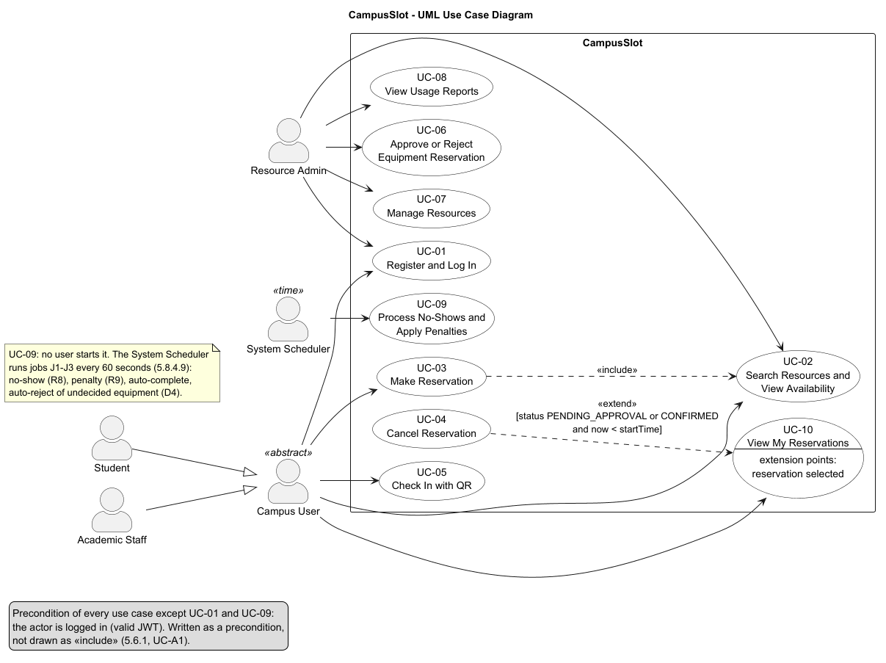

## 5.6 Analysis Models: Use Case Diagram and Use Case Descriptions (draft v1, 25 Nov 2026)

**Owner.** Görkem (QA/Test Engineer). The user stories and DFDs (Zeynep), the activity diagrams (Arzum) and the decision tables (Görkem, separate file) are other parts of 5.6.

**Inputs.** The project card (actors, UC-01 to UC-10, R1–R9, F1–F8, reservation states), the requirements in 5.4 (v2, FR-01 to FR-55, NFR-01 to NFR-23 and the PM defaults D1–D4), the API contract in 5.8 (endpoints E01–E23, error codes, rule chain 5.8.4.7, check-in logic 5.8.4.8, scheduler jobs 5.8.4.9) and the Reservation state machine in 5.7. Actor, use case, state and enum names are used exactly as they appear there. No survey, interview or observation result is used in this section.

### 5.6.1 UML Use Case Diagram

*Figure 5.6-1. UML use case diagram of CampusSlot.* Source: `docs/diagrams/5.6_use-case-diagram_Gorkem.puml`, rendered with PlantUML 1.2026.10 (`java -jar plantuml.jar -Playout=smetana -tpng <file>.puml`).

The diagram shows the system boundary (CampusSlot), the five actors of the project card and the ten use cases UC-01 to UC-10. A use case is a goal that an actor reaches with the system. It is not a screen and not an endpoint; one use case usually uses several endpoints (see the "API" row of each description).

#### Actors

| Actor | Type | Use cases | Note |
|---|---|---|---|
| Campus User | Abstract, human | UC-01, UC-02, UC-03, UC-05, UC-10 (UC-04 through UC-10) | Never appears as a role value. Student and Academic Staff inherit all of its use cases. |
| Student | Human, specialises Campus User | Inherited from Campus User | Role `STUDENT`. Active reservation limit 2 (R2). |
| Academic Staff | Human, specialises Campus User | Inherited from Campus User | Role `ACADEMIC_STAFF`. Active reservation limit 5 (R2). The use cases are the same as for Student; only the R2 limit differs. |
| Resource Admin | Human | UC-01 (log in only), UC-02, UC-06, UC-07, UC-08 | Role `RESOURCE_ADMIN`. Does not reserve and does not check in (D3). The account comes from seed data, not from self-registration (FR-02). |
| System Scheduler | Time-triggered, not a person | UC-09 | Runs inside the backend every 60 seconds (5.8.4.9). |

#### Relationships

| Relationship | From → To | Why |
|---|---|---|
| Generalisation | Student → Campus User, Academic Staff → Campus User | Given in the project card. Both roles do the same things; drawing the associations once on Campus User keeps the diagram readable. |
| `<<include>>` | UC-03 Make Reservation → UC-02 Search Resources and View Availability | A reservation is always made for one resource and one free slot, so finding the resource and looking at its availability is a mandatory part of UC-03 (step 1). UC-02 is also a goal on its own, for example when a user only checks whether a room is free. |
| `<<extend>>` | UC-04 Cancel Reservation → UC-10 View My Reservations | Cancelling is optional behaviour that starts from the reservation list, at the extension point "reservation selected", and only under the condition `status` is `PENDING_APPROVAL` or `CONFIRMED` **and** the start time has not passed (R6). UC-10 is complete without it. For this reason UC-04 has no direct association with Campus User in the diagram. |

**Design decisions (UC-A1 to UC-A3).**

- **UC-A1.** Being logged in is a precondition of every use case except UC-01 and UC-09. It is written as a precondition and not drawn as `<<include>>` of UC-01, because UC-01 also contains registration, which is not part of the other goals, and ten include arrows to the same use case would hide the relationships that carry meaning.
- **UC-A2.** In-app notifications (F4, FR-22, FR-30, FR-42, FR-47) are side effects of UC-03, UC-04, UC-06 and UC-09, and reading them is part of UC-10. They are not a separate use case, because the project card has no UC number for them and creating a notification is never a goal of an actor.
- **UC-A3.** The System Scheduler is drawn as an actor although it runs inside the backend. The reason is that UC-09 is started by time, not by a person, and the diagram must show who starts every use case.

### 5.6.2 Detailed (fully-dressed) use case descriptions

**How to read the descriptions.** "Main flow" is the normal path. An alternative flow is numbered after the step where it branches: `5a` branches at step 5, `*a` can happen at any step. Error codes and HTTP status codes are the ones of the API contract (5.8.4.3). All times are checked with the server clock (NFR-10) in the time zone `Europe/Istanbul`. The "Tests" row names the test cases of the test plan (5.12.3) that check the use case.

---

#### UC-01 Register and Log In

| Field | Content |
|---|---|
| ID and name | UC-01 Register and Log In |
| Primary actor | Campus User (register and log in); Resource Admin (log in only) |
| Stakeholders and interests | Campus User: quick access without paperwork. University: only the personal data that is needed is collected (NFR-05, KVKK). |
| Brief description | A new Campus User creates an account and is logged in; an existing user logs in and gets a token that opens the functions of his or her role. |
| Trigger | The actor opens CampusSlot and is not logged in. |
| Preconditions | For registration: the e-mail address has no account yet. For log in: the account exists. Resource Admin accounts exist from the seed data. |
| Postconditions (success) | The actor holds a valid access token (JWT, 1 hour) that carries the role. After registration a `User` record exists with a password hash, never the plain password (NFR-01). |
| Postconditions (failure) | No token is issued. No `User` record is created. |
| Related FR / NFR | FR-01, FR-02, FR-03, FR-04, FR-05, FR-06; NFR-01, NFR-02, NFR-03, NFR-05, NFR-06 |
| Business rules | D3 (role-based access to the other use cases) |
| API | E01 `POST /auth/register`, E02 `POST /auth/login`, E03 `GET /auth/me` |
| Tests | TC-01 to TC-09 (automated: TC-01 API part, TC-02, TC-03, TC-04, TC-06, TC-07, TC-09) |

**Main flow (log in)**

1. The actor opens the Log in page.
2. The actor enters e-mail and password and submits.
3. The system finds the user by e-mail and compares the password with the stored bcrypt hash.
4. The system creates an access token (valid for 1 hour) with the user id and the role.
5. The system opens the start page for the role: resource search for a Campus User, the admin panel for a Resource Admin.
6. The use case ends.

**Alternative flows**

- **1a. The actor has no account (register).** Only for Campus User.
  1. The actor opens the Register page.
  2. The system shows the form (full name, e-mail, password, role) with the privacy notice and an acceptance checkbox (NFR-06). The role list offers only `STUDENT` and `ACADEMIC_STAFF` (FR-02).
  3. The actor fills in the form, ticks the checkbox and submits.
  4. The system validates the input: full name 2–100 characters, a valid e-mail, password at least 8 characters and at most 72 bytes, privacy notice accepted.
  5. The system checks that the e-mail is not registered.
  6. The system stores the user with the password hash and the chosen role.
  7. The flow continues at step 4 of the main flow: a newly registered user is logged in at once.
- **1a4a. Invalid input or privacy notice not accepted.** The system answers `400 VALIDATION_ERROR` and marks the wrong fields. The flow returns to 1a3.
- **1a5a. E-mail already registered.** The system answers `409 EMAIL_TAKEN` (FR-03). The flow returns to 1a3.
- **3a. Wrong e-mail or password.** The system answers `401 INVALID_CREDENTIALS` and does not say which of the two was wrong (FR-04). The flow returns to step 2.
- **3b. Too many failed attempts** (5 per e-mail and IP in 15 minutes). The system answers `429 RATE_LIMITED`. The actor tries again later. The use case ends.
- **\*a. The token expires** (after 1 hour, during any later use case). The system answers `401 TOKEN_EXPIRED` and the client returns to step 1.
- **\*b. The actor logs out** (FR-06). The client deletes the token. The use case ends.

---

#### UC-02 Search Resources and View Availability

| Field | Content |
|---|---|
| ID and name | UC-02 Search Resources and View Availability |
| Primary actor | Campus User, Resource Admin |
| Stakeholders and interests | Campus User: finds a free room, lab or piece of equipment without asking anyone. Resource Admin: sees the same picture as the users. |
| Brief description | The actor searches and filters the active resources and looks at the booked and free time of one resource on one day. |
| Trigger | The actor needs a resource or wants to know whether one is free. Also step 1 of UC-03 (`<<include>>`). |
| Preconditions | The actor is logged in (UC-A1). |
| Postconditions (success) | The actor has seen the matching resources and the availability of the chosen resource. No data is changed. |
| Postconditions (failure) | No data is changed. |
| Related FR / NFR | FR-07, FR-08, FR-09, FR-10, FR-11, FR-12 |
| Business rules | R3, D2 (which reservations block a slot) |
| API | E04 `GET /resources`, E05 `GET /resources/{id}`, E06 `GET /resources/{id}/availability` |
| Tests | TC-10 to TC-13 |

**Main flow**

1. The actor opens the resource search.
2. The system lists the active resources (name, type, location, capacity, description), sorted by name, 20 per page.
3. The actor types a search text (name or location) and/or chooses a type (`ROOM`, `LAB`, `EQUIPMENT`) and a minimum capacity.
4. The system shows the active resources that match.
5. The actor selects a resource.
6. The system shows the details of the resource.
7. The actor chooses a date.
8. The system shows the availability of that resource on that date: the booked slots (`PENDING_APPROVAL`, `CONFIRMED`, `CHECKED_IN`) and the free gaps between them. The names of the users who booked are not shown.
9. The use case ends (or UC-03 continues, when UC-02 was included).

**Alternative flows**

- **2a. More than one page.** The actor moves to the next page; the system shows it. The flow continues at step 3 or 5.
- **4a. No resource matches.** The system shows an empty result. The flow returns to step 3.
- **6a. The resource is unknown, or deactivated and the actor is not a Resource Admin.** The system answers `404 RESOURCE_NOT_FOUND` (FR-11). The flow returns to step 4.
- **8a. Nothing is booked on that date.** The system shows the whole day as free.

---

#### UC-03 Make Reservation

| Field | Content |
|---|---|
| ID and name | UC-03 Make Reservation |
| Primary actor | Campus User (Student or Academic Staff) |
| Secondary actors | Resource Admin (decides an `EQUIPMENT` reservation later, in UC-06) |
| Stakeholders and interests | Campus User: a guaranteed slot. Other users: fair access (R2, R4) and no double booking (R3). Resource Admin: control over equipment (R5). |
| Brief description | The actor books one resource for one time slot. The system checks the business rules in a fixed order and creates the reservation as `CONFIRMED` (room, lab) or `PENDING_APPROVAL` (equipment). |
| Trigger | The actor wants to use a resource at a certain time. |
| Preconditions | The actor is logged in with the role `STUDENT` or `ACADEMIC_STAFF` (D3). |
| Postconditions (success) | A `Reservation` exists with the status `CONFIRMED` or `PENDING_APPROVAL`. It blocks the slot (D2) and counts toward the R2 limit (D1). A notification `RESERVATION_CONFIRMED` or `RESERVATION_PENDING` exists. |
| Postconditions (failure) | No reservation is stored. The actor sees which rule failed, in plain words (FR-21). |
| Related FR / NFR | FR-13 to FR-22; NFR-08, NFR-10 |
| Business rules | R1, R2, R3, R4, R5; D1, D2, D3 |
| API | E07 `POST /reservations` (rule chain 5.8.4.7) |
| Tests | TC-14 to TC-23; decision table DT-1 (5.6.5); boundaries: exactly 3 hours (TC-16), back-to-back slots (TC-20) |

**Main flow**

1. The actor finds a resource and a free slot (include UC-02).
2. The actor enters the start time, the end time and an optional purpose (at most 200 characters) and confirms.
3. The system checks that the end time is after the start time and that the start time is not in the past.
4. The system checks that the resource exists and is active.
5. The system checks R1: the reservation lasts at most 3 hours. Exactly 3 hours is allowed.
6. The system checks R4: the actor has no running penalty.
7. The system checks R2: the actor has fewer active reservations than the limit (Student 2, Academic Staff 5). Active means a start in the future and the status `PENDING_APPROVAL` or `CONFIRMED` (D1).
8. The system checks R3: no reservation with the status `PENDING_APPROVAL`, `CONFIRMED` or `CHECKED_IN` on the same resource overlaps the new one. Back-to-back slots (10:00–11:00 and 11:00–12:00) do not overlap.
9. The system sets the status by R5: the resource is a `ROOM` or `LAB`, so the status is `CONFIRMED`.
10. The system stores the reservation and a notification `RESERVATION_CONFIRMED`. Steps 7 to 10 run in one database transaction.
11. The system shows the new reservation with its status.
12. The use case ends.

**Alternative flows**

- **\*a. The actor is a Resource Admin.** The system answers `403 FORBIDDEN` (D3). The use case ends.
- **2a. Input is incomplete or a time has no offset.** The system answers `400 VALIDATION_ERROR`. The flow returns to step 2.
- **3a. End time not after start time, or start time in the past.** The system answers `422 INVALID_TIME_RANGE` or `422 START_IN_PAST` (FR-20). The flow returns to step 2.
- **4a. The resource is deactivated.** The system answers `422 RESOURCE_INACTIVE` (FR-11). The use case ends.
- **5a. Longer than 3 hours.** The system answers `422 RULE_R1_MAX_DURATION` and states the limit (FR-14). The flow returns to step 2.
- **6a. The actor has a running penalty.** The system answers `422 RULE_R4_ACTIVE_PENALTY` and shows when the penalty ends (FR-17). The use case ends.
- **7a. The active reservation limit is reached.** The system answers `422 RULE_R2_ACTIVE_LIMIT` with the limit and the current count (FR-15). The use case ends. The actor may cancel another reservation (UC-04) and start again.
- **8a. The slot overlaps another reservation.** The system answers `409 RULE_R3_OVERLAP` (FR-16). The flow returns to step 1.
- **8b. Two actors book the same slot at the same moment.** The database refuses the second insert and the second actor gets `409 RULE_R3_OVERLAP` (NFR-08). The flow returns to step 1 for that actor.
- **9a. The resource is `EQUIPMENT`.** The system sets the status `PENDING_APPROVAL` (R5, FR-19) and stores a notification `RESERVATION_PENDING`. The reservation now waits for UC-06. The flow continues at step 11.

---

#### UC-04 Cancel Reservation

| Field | Content |
|---|---|
| ID and name | UC-04 Cancel Reservation (`<<extend>>` UC-10 at "reservation selected") |
| Primary actor | Campus User (owner of the reservation) |
| Stakeholders and interests | Campus User: gets out of a booking without a no-show. Other users: the slot becomes free again. |
| Brief description | The owner cancels a reservation that has not started yet. The slot is freed and the reservation no longer counts toward R2. |
| Trigger | In UC-10 the actor selects a reservation and chooses Cancel. |
| Preconditions | The actor is logged in (UC-A1) and owns the reservation. Extension condition: the status is `PENDING_APPROVAL` or `CONFIRMED` and the start time has not passed. |
| Postconditions (success) | The status is `CANCELLED` and `cancelledAt` is set. The slot is free and the reservation is not active (FR-27). A notification `RESERVATION_CANCELLED` exists. |
| Postconditions (failure) | The reservation is unchanged. |
| Related FR / NFR | FR-25, FR-26, FR-27, FR-30; NFR-10 |
| Business rules | R6; D1, D2 |
| API | E10 `POST /reservations/{id}/cancel` |
| Tests | TC-24, TC-25, TC-26, TC-30; boundary: cancel 1 s before and exactly at the start (TC-25) |

**Main flow**

1. In UC-10 the actor selects one of his or her reservations and chooses Cancel.
2. The system asks for confirmation.
3. The actor confirms.
4. The system loads the reservation and checks that the actor owns it.
5. The system checks that the status is `PENDING_APPROVAL` or `CONFIRMED`.
6. The system checks R6: the current server time is before the start time.
7. The system sets the status to `CANCELLED`, records `cancelledAt` and stores a notification `RESERVATION_CANCELLED`.
8. The system shows the updated reservation list. The flow returns to UC-10.

**Alternative flows**

- **3a. The actor does not confirm.** Nothing changes. The flow returns to UC-10.
- **4a. The reservation is unknown or belongs to another user.** The system answers `404 RESERVATION_NOT_FOUND`, so the actor cannot learn which ids belong to others. The use case ends.
- **5a. The status is `CHECKED_IN`, `COMPLETED`, `CANCELLED`, `NO_SHOW` or `REJECTED`.** The system answers `409 INVALID_STATE_TRANSITION`. The use case ends.
- **6a. The start time has passed (at or after the start).** The system answers `422 RULE_R6_CANCEL_AFTER_START` (FR-26). The use case ends.

---

#### UC-05 Check In with QR

| Field | Content |
|---|---|
| ID and name | UC-05 Check In with QR |
| Primary actor | Campus User (owner of the reservation) |
| Stakeholders and interests | Campus User: keeps the reservation and avoids a no-show. University: proof that the resource is really used. |
| Brief description | At the door, the actor scans the QR code of the resource (or types its 6-digit code). Inside the check-in window the reservation becomes `CHECKED_IN`. |
| Trigger | The actor arrives at the resource. |
| Preconditions | The actor is logged in (UC-A1) on a phone or computer with a browser over HTTPS (NFR-04). The actor has a `CONFIRMED` reservation on this resource. |
| Postconditions (success) | A `CheckIn` record exists with the time and the method (`QR_SCAN` or `MANUAL_CODE`). The status is `CHECKED_IN`, so the reservation cannot become `NO_SHOW`. UC-09 later sets it to `COMPLETED`. |
| Postconditions (failure) | No `CheckIn` record. The status is unchanged. The actor sees the reason (FR-37). |
| Related FR / NFR | FR-31 to FR-37; NFR-09, NFR-10, NFR-12, NFR-16, NFR-17, NFR-18 |
| Business rules | R7, R5 (a pending reservation cannot be checked in), D3 |
| API | E11 `POST /check-ins` (logic 5.8.4.8) |
| Tests | TC-31 to TC-34, TC-49, TC-51; decision table DT-2 rules DT2-1 to DT2-3; boundaries: exactly 10 minutes before and 15 minutes after the start (TC-33) |

**Main flow**

1. The actor opens the Check-in page.
2. The system opens the camera.
3. The actor scans the QR code on the door.
4. The system sends the scanned token with the method `QR_SCAN`.
5. The system finds the resource whose QR token matches.
6. The system finds the actor's `CONFIRMED` reservation on that resource where start − 10 minutes ≤ now ≤ start + 15 minutes. Both ends are inclusive (R7).
7. In one transaction the system creates the `CheckIn` record and sets the status to `CHECKED_IN`.
8. The system shows the confirmation with the check-in time.
9. The use case ends.

**Alternative flows**

- **\*a. The actor is a Resource Admin.** The system answers `403 FORBIDDEN` (D3). The use case ends.
- **2a. The camera does not open or the permission is refused.** The actor types the 6-digit code from under the QR code on the same screen (FR-33, NFR-16). The system sends it with the method `MANUAL_CODE` and finds the resource by its check-in code. The flow continues at step 6.
- **5a. No resource matches the code.** The system answers `404 CHECKIN_CODE_INVALID`. The flow returns to step 3.
- **5b. Too many failed attempts** (10 per user in 5 minutes). The system answers `429 RATE_LIMITED`. The use case ends.
- **6a. The reservation is already checked in.** The system answers `409 ALREADY_CHECKED_IN` (FR-36). The use case ends.
- **6b. Too early (more than 10 minutes before the start).** The system answers `422 RULE_R7_TOO_EARLY` and shows when the window opens. The actor may return later. The use case ends.
- **6c. Too late (more than 15 minutes after the start).** The system answers `422 RULE_R7_TOO_LATE`. The reservation becomes `NO_SHOW` in UC-09 (R8). The use case ends.
- **6d. The reservation is still `PENDING_APPROVAL`.** The system answers `422 RESERVATION_NOT_CONFIRMED`. The use case ends.
- **6e. The actor has no reservation on this resource at this time.** The system answers `404 NO_RESERVATION_HERE`. The use case ends.

---

#### UC-06 Approve or Reject Equipment Reservation

| Field | Content |
|---|---|
| ID and name | UC-06 Approve or Reject Equipment Reservation |
| Primary actor | Resource Admin |
| Secondary actors | Campus User (receives the decision as a notification) |
| Stakeholders and interests | Resource Admin: controls who gets equipment (R5). Campus User: a quick decision with a reason when rejected. |
| Brief description | The Resource Admin looks at the `EQUIPMENT` reservations that wait for a decision and approves or rejects each of them. |
| Trigger | The admin opens the pending approvals list. |
| Preconditions | The actor is logged in with the role `RESOURCE_ADMIN` (UC-A1). |
| Postconditions (success) | The reservation is `CONFIRMED` (approved) or `REJECTED` with a reason (rejected). `decidedById` and `decidedAt` are recorded. The user has a notification `RESERVATION_APPROVED` or `RESERVATION_REJECTED`. A rejected reservation frees the slot and does not count toward R2 (FR-48). |
| Postconditions (failure) | The reservation is unchanged. |
| Related FR / NFR | FR-44, FR-45, FR-46, FR-47, FR-48; related: FR-55 (UC-09) |
| Business rules | R5; D1, D2, D4 |
| API | E14 `GET /admin/reservations/pending`, E09 `GET /reservations/{id}`, E15 `POST /admin/reservations/{id}/approve`, E16 `POST /admin/reservations/{id}/reject` |
| Tests | TC-41, TC-42, TC-43 |

**Main flow**

1. The admin opens Pending approvals.
2. The system lists the `PENDING_APPROVAL` reservations with user, resource, time and purpose, the soonest start first.
3. The admin selects a reservation and looks at its details.
4. The admin chooses Approve.
5. The system checks that the status is still `PENDING_APPROVAL` and that the start time has not passed.
6. The system sets the status to `CONFIRMED` and records `decidedById` and `decidedAt`.
7. The system stores a notification `RESERVATION_APPROVED` for the user.
8. The system removes the reservation from the list. The flow returns to step 2 or the use case ends.

**Alternative flows**

- **2a. The list is empty.** The system says that nothing is waiting. The use case ends.
- **4a. The admin chooses Reject.**
  1. The admin enters a reason (1–500 characters) and confirms.
  2. The system checks the status and the start time as in step 5.
  3. The system sets the status to `REJECTED`, stores the reason, `decidedById` and `decidedAt`. The slot is free again (D2).
  4. The system stores a notification `RESERVATION_REJECTED` for the user. The flow continues at step 8.
- **4a1a. No reason entered.** The system answers `400 VALIDATION_ERROR`. The flow returns to 4a1.
- **5a. The start time has passed.** The system answers `422 RESERVATION_ALREADY_STARTED`. UC-09 rejects this reservation automatically (D4, FR-55). The flow returns to step 2.
- **5b. The status changed meanwhile** (the user cancelled, or another admin decided). The system answers `409 INVALID_STATE_TRANSITION` and refreshes the list. The flow returns to step 2.

---

#### UC-07 Manage Resources

| Field | Content |
|---|---|
| ID and name | UC-07 Manage Resources |
| Primary actor | Resource Admin |
| Stakeholders and interests | Resource Admin: an up-to-date list of rooms, labs and equipment, and door codes to print. Campus User: only real, usable resources are offered. |
| Brief description | The admin adds a resource, edits it, or deactivates and reactivates it. The system generates the QR token and the 6-digit door code. |
| Trigger | A resource is added, changes, or is taken out of use. |
| Preconditions | The actor is logged in with the role `RESOURCE_ADMIN` (UC-A1). |
| Postconditions (success) | The resource is stored. A new resource has a unique QR token and a unique 6-digit code (FR-31, FR-50, NFR-09). A deactivated resource is not offered for booking (FR-11) but stays in the database. |
| Postconditions (failure) | No resource is created or changed. |
| Related FR / NFR | FR-11, FR-31, FR-49, FR-50, FR-51; NFR-09 |
| Business rules | R5 (the type decides whether approval is needed, so the type cannot be changed later) |
| API | E17 `GET /admin/resources`, E18 `POST /admin/resources`, E19 `PATCH /admin/resources/{id}` |
| Tests | TC-44, TC-45 |

**Main flow (add a resource)**

1. The admin opens Resources in the admin panel.
2. The system lists all resources, including the inactive ones, with their QR token and 6-digit code.
3. The admin chooses Add resource.
4. The admin enters name, type (`ROOM`, `LAB` or `EQUIPMENT`), location, capacity (for `ROOM` and `LAB`) and an optional description, and saves.
5. The system validates the input.
6. The system generates a unique QR token and a unique 6-digit check-in code. The admin does not type them (FR-50).
7. The system stores the resource as active.
8. The system shows the new resource with its QR code and 6-digit code, ready to print for the door.
9. The use case ends.

**Alternative flows**

- **3a. Edit a resource.** The admin selects a resource and changes name, location, capacity or description. The type cannot be changed (R5). The system validates and saves. The flow continues at step 8.
- **3b. Deactivate or reactivate a resource.** The admin selects a resource and sets it inactive (or active again). The resource is not deleted (FR-51). An inactive resource is not offered to Campus Users and cannot be booked (FR-11). The flow returns to step 2. What happens to future reservations on a deactivated resource is still open [TBD: Product Owner, 5.4 F8].
- **5a. Invalid input** (for example a `ROOM` without capacity). The system answers `400 VALIDATION_ERROR` and marks the field. The flow returns to step 4.

---

#### UC-08 View Usage Reports

| Field | Content |
|---|---|
| ID and name | UC-08 View Usage Reports |
| Primary actor | Resource Admin |
| Stakeholders and interests | Resource Admin and university management: facts on how much the resources are used and how often bookings are wasted. |
| Brief description | The admin chooses a period and sees the occupancy and no-show figures per resource, the users with no-shows and the penalties. |
| Trigger | The admin needs usage figures, for example at the end of a month. |
| Preconditions | The actor is logged in with the role `RESOURCE_ADMIN` (UC-A1). |
| Postconditions (success) | The admin has seen the reports. No data is changed. |
| Postconditions (failure) | No data is changed. |
| Related FR / NFR | FR-52, FR-53, FR-54 |
| Business rules | R8, R9 (the source of no-show and penalty data) |
| API | E20 `GET /admin/reports/usage`, E21 `GET /admin/reports/no-shows`, E22 `GET /admin/penalties` (formulas 5.8.4.10) |
| Tests | TC-46, TC-47 |

**Main flow**

1. The admin opens Reports.
2. The admin chooses a period (from and to, calendar days in `Europe/Istanbul`) and, optionally, a resource type.
3. The system calculates for each resource the number of reservations, the booked hours, the occupancy rate, the number of no-shows and the no-show rate (formulas in 5.8.4.10).
4. The system shows the usage table.
5. The admin opens the no-show report.
6. The system lists the users with no-shows in the period, with their number of no-shows and the last no-show, the highest number first.
7. The admin opens the penalties list.
8. The system lists the running penalties with user, reason, start and end.
9. The use case ends.

**Alternative flows**

- **2a. Invalid period** (for example "to" before "from"). The system answers `400 VALIDATION_ERROR`. The flow returns to step 2.
- **3a. No reservation in the period.** The system shows zero values; a no-show rate with a divisor of 0 is shown as empty (`null`).
- **3b. Occupancy rate.** The daily opening hours needed for the occupancy rate are not known yet [TBD: H08, API-A8].
- **8a. The admin also wants ended penalties.** The admin switches the filter; the system lists all penalties.

---

#### UC-09 Process No-Shows and Apply Penalties

| Field | Content |
|---|---|
| ID and name | UC-09 Process No-Shows and Apply Penalties |
| Primary actor | System Scheduler |
| Secondary actors | Campus User (offstage: receives notifications and may be banned) |
| Stakeholders and interests | Other users: slots that nobody uses are freed. University: repeated no-shows have a consequence (R9). Campus User: a penalty only when the rule is really met. |
| Brief description | Every 60 seconds the scheduler marks unused reservations as `NO_SHOW`, applies the 7-day penalty after 3 no-shows in 30 days, completes reservations that have ended and rejects equipment reservations that nobody decided in time. |
| Trigger | Time: every 60 seconds (5.8.4.9). |
| Preconditions | The backend process is running. |
| Postconditions (success) | No `CONFIRMED` reservation whose start was more than 15 minutes ago remains. Every user with 3 or more `NO_SHOW` in the last 30 days has a running penalty. No `CHECKED_IN` reservation that has ended remains. No `PENDING_APPROVAL` reservation whose start has passed remains. Each reservation was processed only once (NFR-14). |
| Postconditions (failure) | Rows that were not processed stay unchanged and are processed in the next run. |
| Related FR / NFR | FR-38, FR-39, FR-40, FR-41, FR-42, FR-55; NFR-10, NFR-14 |
| Business rules | R8, R9; D4 |
| API | No endpoint. Scheduler jobs J3, J1, J2 (5.8.4.9) |
| Tests | TC-35 to TC-40; decision table DT-2 rules DT2-4 to DT2-7; boundaries: no-show at start + 15 min and + 15 min 1 s (TC-35), third no-show inside and outside 30 days (TC-36, TC-37) |

**Main flow** (one run, in the job order of 5.8.4.9)

1. The timer starts a run.
2. (J3) The system finds the `PENDING_APPROVAL` reservations whose start time has passed, sets them to `REJECTED` with the reason "Not approved before the start time" and stores a notification `RESERVATION_REJECTED` for each user (D4, FR-55).
3. (J1) The system finds the `CONFIRMED` reservations with start + 15 minutes < now, sets them to `NO_SHOW` and stores a notification `NO_SHOW_RECORDED`. The slot is free (R8, FR-39, FR-40).
4. For each user from step 3, the system counts the `NO_SHOW` reservations whose start time is in the last 30 days (API-A7).
5. The count is 3 or more and the user has no running penalty, so the system creates a `Penalty` from now to now + 7 days with the number of no-shows, and stores a notification `PENALTY_APPLIED` (R9, FR-41, FR-42).
6. (J2) The system sets the `CHECKED_IN` reservations whose end time has passed to `COMPLETED` (FR-38).
7. The run ends. The next run starts 60 seconds later.

**Alternative flows**

- **2a / 3a / 6a. Nothing to process.** The step does nothing and the run continues.
- **5a. Fewer than 3 no-shows in the last 30 days.** No penalty is created. The flow continues at step 6.
- **5b. The user already has a running penalty.** No second penalty is created. The flow continues at step 6.
- **\*a. The server was stopped or asleep.** At the first run after the restart, all reservations that became due in the meantime are processed once, because the conditions use "before now" (NFR-14).
- **\*b. A row changed between selecting and updating it** (for example the user checked in exactly at start + 15 minutes, or cancelled). The update is conditional on the old status, so 0 rows change and the reservation is skipped.

**Open points.** Whether the no-shows that already caused a penalty count again for the next one [TBD: H09, Product Owner]. The check-in reminder (job J4, FR-30) runs in the same scheduler run but is a notification, not part of this goal (UC-A2).

---

#### UC-10 View My Reservations

| Field | Content |
|---|---|
| ID and name | UC-10 View My Reservations (extension point "reservation selected", used by UC-04) |
| Primary actor | Campus User |
| Stakeholders and interests | Campus User: one place to see all bookings, their status, decisions and messages. |
| Brief description | The actor sees his or her reservations with their status, the R2 counter and a running penalty, and reads the in-app notifications. |
| Trigger | The actor wants to check his or her bookings or has a new notification. |
| Preconditions | The actor is logged in as `STUDENT` or `ACADEMIC_STAFF` (UC-A1). |
| Postconditions (success) | The actor has seen the reservations. Notifications that the actor marked are read. |
| Postconditions (failure) | No data is changed. |
| Related FR / NFR | FR-23, FR-24, FR-28, FR-29, FR-30, FR-43 |
| Business rules | R2 (counter), R4 (penalty end), R5 (rejection reason) |
| API | E03 `GET /auth/me`, E08 `GET /reservations/me`, E09 `GET /reservations/{id}`, E12 `GET /notifications`, E13 `PATCH /notifications/{id}/read` |
| Tests | TC-27 to TC-30 |

**Main flow**

1. The actor opens My Reservations.
2. The system lists the actor's reservations (resource, start, end, status, purpose), the latest start first, and shows the number of active reservations against the R2 limit and, if there is one, the end of the running penalty (FR-43).
3. The actor filters by status (optional).
4. The system shows the filtered list.
5. The actor selects a reservation. **Extension point: reservation selected** (UC-04 Cancel Reservation).
6. The system shows the details: status, the rejection reason for a `REJECTED` reservation (FR-24), and the check-in time and method for a checked-in one.
7. The actor opens Notifications.
8. The system lists the actor's notifications, the newest first, with a read or unread mark and the number of unread ones (FR-28).
9. The actor marks a notification as read. The system saves it (FR-29).
10. The use case ends.

**Alternative flows**

- **2a. The actor has no reservations.** The system shows an empty list. The flow continues at step 7 or the use case ends.
- **5a. The actor wants to cancel** (the status is `PENDING_APPROVAL` or `CONFIRMED` and the start has not passed). UC-04 extends UC-10 here. After UC-04 the flow returns to step 2.
- **5b. The reservation id is not the actor's own** (for example a changed link). The system answers `404 RESERVATION_NOT_FOUND`. The flow returns to step 2.
- **9a. The notification is not the actor's own.** The system answers `404 NOTIFICATION_NOT_FOUND`. The flow returns to step 8.

---

### 5.6.3 Traceability: functional requirements to use cases

Every functional requirement in 5.4 belongs to at least one use case. This table replaces the provisional UC mapping in the FR tables of 5.4.

| Use case | Functional requirements | Count |
|---|---|---|
| UC-01 Register and Log In | FR-01, FR-02, FR-03, FR-04, FR-05, FR-06 | 6 |
| UC-02 Search Resources and View Availability | FR-07, FR-08, FR-09, FR-10, FR-11, FR-12 | 6 |
| UC-03 Make Reservation | FR-13, FR-14, FR-15, FR-16, FR-17, FR-18, FR-19, FR-20, FR-21, FR-22 | 10 |
| UC-04 Cancel Reservation | FR-25, FR-26, FR-27 | 3 |
| UC-05 Check In with QR | FR-32, FR-33, FR-34, FR-35, FR-36, FR-37 | 6 |
| UC-06 Approve or Reject Equipment Reservation | FR-44, FR-45, FR-46, FR-47, FR-48 | 5 |
| UC-07 Manage Resources | FR-31, FR-49, FR-50, FR-51 | 4 |
| UC-08 View Usage Reports | FR-52, FR-53, FR-54 | 3 |
| UC-09 Process No-Shows and Apply Penalties | FR-38, FR-39, FR-40, FR-41, FR-42, FR-55 | 6 |
| UC-10 View My Reservations | FR-23, FR-24, FR-28, FR-29, FR-30, FR-43 | 6 |
| **Total** | | **55** |

FR-11 (inactive resources are not bookable) is counted under UC-02 but is also checked in UC-03 (step 4) and set in UC-07. FR-31 (every resource has a QR code and a 6-digit code) is counted under UC-07, where the codes are created, and used in UC-05. FR-30 (notification events) is counted under UC-10, where notifications are read; the notifications are created in UC-03, UC-04, UC-06 and UC-09 (UC-A2).

**Differences from the provisional mapping in 5.4.** 5.4 maps FR-38 to UC-09 and FR-54 to F8 only; here FR-54 is placed in UC-08, as in the API coverage table (5.8.4.11). FR-31 has no UC in 5.4 and is placed in UC-07. FR-55 has no UC in 5.4 and is placed in UC-09, as job J3 in 5.8.4.9. No other mapping changed.

### 5.6.4 Notes on sources

- Actors, use case names and numbers, rules R1–R9 and states: project card (team document, no external source).
- Requirements, D1–D4 and NFRs: section 5.4 v2 in this repository (pulled 25 Nov 2026).
- Error codes, endpoints, rule order, check-in window and scheduler jobs: section 5.8 (API design, draft v1) in this repository.
- The template fields (actors, stakeholders and interests, preconditions, postconditions, main flow, alternative flows) follow the common "fully-dressed" use case form. [TBD: Arzum or Görkem adds the textbook reference used in the course to 5.15; no book was opened for this draft.]
- The UML notation (`<<include>>`, `<<extend>>`, generalisation of actors) follows the UML use case notation. [TBD: add the OMG UML specification or the course textbook to 5.15 if required.]
