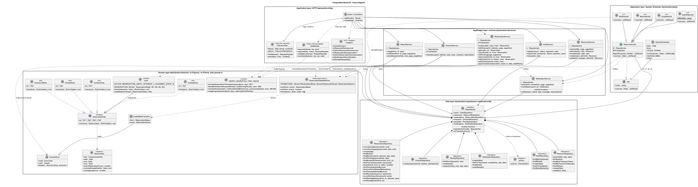

## 5.7 Software Design: Class Diagram (draft v1, 26 Nov 2026)

**Owner.** Erol (Backend Developer).
**Status.** Drawn from the backend code on the branch `erol/backend-api` (26 Nov 2026). Every class, field and method in the diagram exists in `backend/src` with the same name. The persistent entities (User, Resource, Reservation, CheckIn, Penalty, Notification) are shown in the ERD in 5.8.3, so that this diagram stays readable.

Diagram: `docs/diagrams/5.7_class-diagram_Erol.puml` (PNG: `5.7_class-diagram_Erol.png` [TBD: render with PlantUML, H44]).

### 5.7.c.1 Layers and packages

The packages follow the layers of 5.8.1. An arrow never points from a lower layer to a higher one: the Domain layer imports neither Express nor Prisma, and it has no clock of its own (the current time `now` is passed in).

| Package | Folder | Classes |
|---|---|---|
| Application: HTTP | `backend/src/http` | route chain (`apiRouter`, `createApp`), middleware `requireAuth`, `requireRole`, `validate`, `errorHandler`, `FailureLimiter`, DTO mappers |
| Application: services | `backend/src/services` | `AuthService`, `ResourceService`, `ReservationService`, `CheckInService`, `NotificationService`, `ReportService` |
| Application: scheduler | `backend/src/jobs` | `SystemScheduler`, `Job`, `ReservationJob`, `AutoRejectJob` (J3), `NoShowJob` (J1), `CompleteJob` (J2), `ReminderJob` (J4) |
| Domain | `backend/src/domain` | `ReservationRule`, `RuleContext`, `DurationRule`, `PenaltyRule`, `ActiveLimitRule`, `OverlapRule`, `ReservationStateMachine`, `DomainError`, `InvalidStateTransition`; functions for R5–R9 and the report formulas |
| Data | `backend/src/repositories`, `backend/src/db` | `Repositories`, `UserRepository`, `ResourceRepository`, `ReservationRepository`, `CheckInRepository`, `PenaltyRepository`, `NotificationRepository`, the `prisma` singleton |

### 5.7.c.2 Main classes

| Class | Responsibility | Rules / FR |
|---|---|---|
| `ReservationService` | Runs E07: time checks, resource check, then in one transaction the rule chain R1 → R4 → R2 → R3, R5, insert and notification. Also cancel (E10), approve and reject (E15, E16). | R1–R6, FR-13 – FR-27, FR-44 – FR-48 |
| `ReservationRule` and its four classes | One business rule each; `check(ctx)` returns `null` or the error. | R1, R2, R3, R4 |
| `ReservationStateMachine` | Table of the allowed status changes T3–T10; `next(from, event)` returns the new status or throws `InvalidStateTransition` (409). | State machine (5.7, Enes) |
| `CheckInService` | Finds the resource by QR token or 6-digit code, picks the reservation in the R7 window (`chooseReservationForCheckIn`), creates the CheckIn and sets `CHECKED_IN` in one transaction. | R7, FR-31 – FR-37 |
| `SystemScheduler` | Runs the four jobs every 60 seconds in the order J3, J1, J2, J4; `runOnce(now)` is used by the tests. | R8, R9, D4, FR-38 – FR-42, FR-55 |
| `NoShowJob` | Sets `NO_SHOW` and, if `decidePenalty` says so, creates the 7-day Penalty in the same transaction. | R8, R9 |
| `ReservationRepository` | All reservation queries the services and jobs need, for example `countActiveByUser`, `countOverlapping`, and `transition` (conditional update, so no reservation is processed twice). | D1, D2, NFR-14 |
| `FailureLimiter` | Counts failed logins (5 per e-mail and IP in 15 min) and failed check-ins (10 per user in 5 min); answers 429. | API-A6, ST-07, ST-08 |

### 5.7.c.3 Design patterns in the code

The patterns described in 5.7 Design Patterns (Batuhan) are implemented with the class names of that section (H40):

| Pattern | Classes in the diagram | File |
|---|---|---|
| P1 Strategy | `ReservationRule` ← `DurationRule`, `PenaltyRule`, `ActiveLimitRule`, `OverlapRule`; ordered list `RESERVATION_RULES` | `backend/src/domain/rules/` |
| P2 State (table-driven) | `ReservationStateMachine`, `InvalidStateTransition` | `backend/src/domain/state/ReservationStateMachine.ts` |
| P3 Repository | `Repositories` and the six repositories | `backend/src/repositories/` |
| P4 Chain of Responsibility | `requireAuth` → `requireRole` → `FailureLimiter` → `validate` → controller → `errorHandler` | `backend/src/http/routes.ts`, `backend/src/http/middleware/` |
| P5 Singleton | `prisma` | `backend/src/db/prisma.ts` |
| P6 DTO + Mapper | `mappers` | `backend/src/http/dto/mappers.ts` |

Two small differences from the draft of 5.7 Design Patterns, for Batuhan to check (H06, DP-1):
- R5 is the function `initialStatusFor(type)`, not a fifth `ReservationRule`, because it never refuses a request; it only chooses the status (5.8.4.7 step 5).
- `ReservationJob` is an abstract base class of the four jobs. It holds the code that every job shares: one transaction and one `try` per reservation (5.8.5.2 A10).

### 5.7.c.4 Sources

- Project files: `backend/src/**` (branch `erol/backend-api`), 5.7 Design Patterns, 5.7 State Machine, 5.8.1, 5.8.4.
