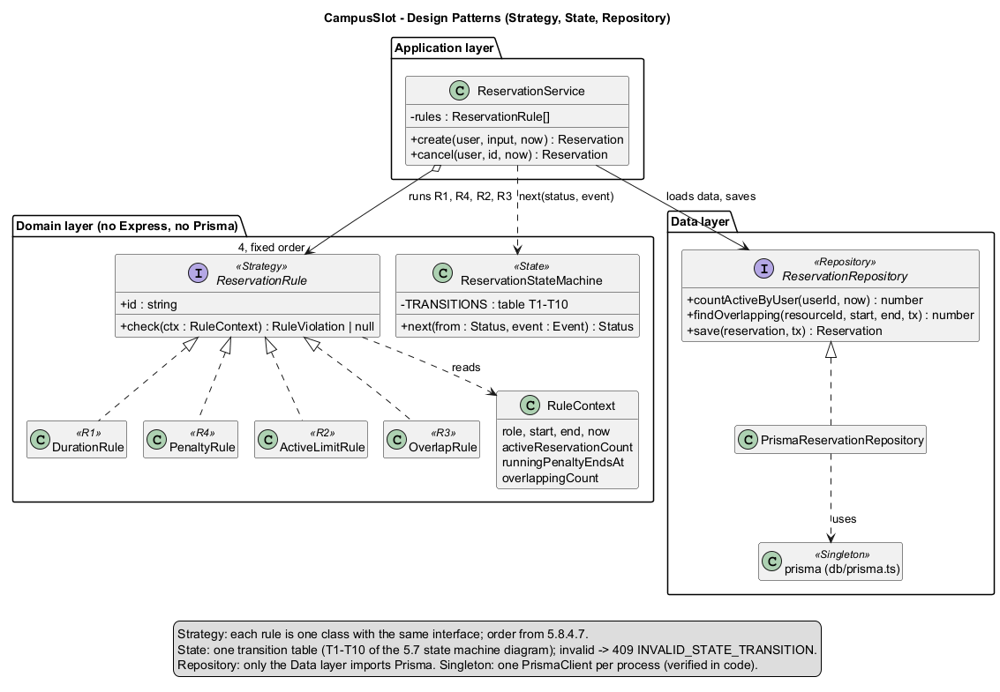

## 5.7 Software Design: Design Patterns (v2, checked against the code on 27 Nov 2026)

**Owner.** Cemal Batuhan Baş (System Architect).
**Status.** The first draft (25 Nov) was written from the architecture in 5.8.1 before the backend existed. On 27 Nov 2026 every pattern was checked against the backend on `main` (merge of `erol/backend-api`, commit `91404a4`): all six are in the code with the class names of this section, and the code added a seventh (P7). The class diagram (Erol, `5.7_class-diagram_Erol.png`) uses the same names. Code excerpts below are quoted from `main`.

Diagram: `docs/diagrams/5.7_design-patterns_Batuhan.puml` (PNG: `5.7_design-patterns_Batuhan.png`).



### 5.7.x.1 Overview

| # | Pattern | Type (GoF = "Gang of Four" catalogue) | Problem in CampusSlot | Where | Status |
|---|---|---|---|---|---|
| P1 | Strategy | GoF, behavioural | Four reservation rules (R1–R4) must run in a fixed order, each with its own error, and must be testable one by one. | `backend/src/domain/rules/` (`RESERVATION_RULES`, `firstViolation`) | **Verified in code** |
| P2 | State (table-driven) | GoF, behavioural | The same action (cancel, check in, approve) is allowed in one status and refused in another. | `backend/src/domain/state/ReservationStateMachine.ts` | **Verified in code** |
| P3 | Repository | Enterprise application pattern | Services must not depend on Prisma, so the Domain stays free of the database and tests can use fake data. | `backend/src/repositories/` (six repositories, `inTransaction`) | **Verified in code** |
| P4 | Chain of Responsibility | GoF, behavioural | Every request must pass the same checks (token, role, input) in the same order before it reaches a controller. | `backend/src/http/routes.ts` + `http/middleware/` | **Verified in code** |
| P5 | Singleton (module instance) | GoF, creational | Only one database connection pool may exist per process. | `backend/src/db/prisma.ts` | **Verified in code** |
| P6 | Data Transfer Object + Mapper | Enterprise application pattern | The API must never send `passwordHash` or the door codes to the wrong role. | `backend/src/http/dto/mappers.ts` | **Verified in code** |

### P1 Strategy: one class per reservation rule

**Problem.** E07 (make a reservation) must check R1, R4, R2 and R3 in this order and stop at the first failure (5.8.4.7). If all checks are written in one long function, a change in one rule can break another, and a test for R2 also has to satisfy R1, R3 and R4.

**Solution.** Each rule is a separate class with the same interface, `ReservationRule`. The ReservationService holds the rules in a list in the fixed order and runs them one by one. Adding a rule means adding a class to the list. Removing or reordering a rule does not touch the others.

```ts
// backend/src/domain/rules/ReservationRule.ts (on main, comments shortened)
export interface ReservationRule {
  readonly id: 'R1' | 'R2' | 'R3' | 'R4'
  check(ctx: RuleContext): RuleViolation | null   // null = passed
}

// The Domain receives plain data; it never queries the database itself (5.8.1).
export interface RuleContext {
  role: 'STUDENT' | 'ACADEMIC_STAFF'
  start: Date
  end: Date
  now: Date                      // server time, given from outside (NFR-10)
  activeReservationCount: number // loaded by the service through a repository (D1)
  runningPenaltyEndsAt: Date | null
  overlappingCount: number       // loaded inside the transaction
}

// backend/src/domain/rules/index.ts (on main): fixed order R1 -> R4 -> R2 -> R3 (5.8.4.7, DT-1 in 5.6)
export const RESERVATION_RULES: readonly ReservationRule[] = [
  new DurationRule(), new PenaltyRule(), new ActiveLimitRule(), new OverlapRule(),
]
export function firstViolation(ctx: RuleContext, rules = RESERVATION_RULES): RuleViolation | null {
  for (const rule of rules) {
    const violation = rule.check(ctx)
    if (violation) return violation
  }
  return null
}
```

| Class | Rule | Error (5.8.4.3) |
|---|---|---|
| `DurationRule` | R1: end − start ≤ 180 minutes | `422 RULE_R1_MAX_DURATION` |
| `PenaltyRule` | R4: no penalty with `startsAt ≤ now < endsAt` | `422 RULE_R4_ACTIVE_PENALTY` |
| `ActiveLimitRule` | R2: active count < 2 (Student) or 5 (Academic Staff) | `422 RULE_R2_ACTIVE_LIMIT` |
| `OverlapRule` | R3: no overlapping reservation that blocks the slot (D2) | `409 RULE_R3_OVERLAP` |

**R5 is a function, not a rule class.** R5 never refuses a reservation; it only chooses the first status. The code therefore has `initialStatusFor(type)` next to the rule list (`EQUIPMENT` → `PENDING_APPROVAL`, `ROOM` and `LAB` → `CONFIRMED`) instead of a fifth `ReservationRule`. This keeps the Strategy list to rules that can say "no". If the rules called the database themselves, the Domain layer would depend on Prisma, and the unit tests would need a database (NFR-21). The service loads the counts through repositories and passes plain numbers and dates. The `now` value comes from outside, so a test can check the exact boundary (for example, exactly 180 minutes).

**R3 has a second guard.** `OverlapRule` gives the user a clear error. The database exclusion constraint (H02) stops the rare case where two requests pass the rule at the same moment (NFR-08). The pattern does not replace the constraint.

**Requirements.** R1–R4, FR-14 to FR-17, NFR-21. Test cases in 5.12 and decision table DT-1 in 5.6 follow the same order.

### P2 State: ReservationStateMachine

**Problem.** A reservation has seven statuses (5.7 state machine, Enes). Cancel is allowed only in `PENDING_APPROVAL` and `CONFIRMED`; check-in only in `CONFIRMED`; approve only in `PENDING_APPROVAL`. If every service checked the status with its own `if`, the rules would be repeated in many places and would drift apart.

**Solution.** One class, `ReservationStateMachine`, holds the table of allowed transitions T1–T10 from Enes's state machine diagram. A service asks the machine for the next status; a transition that is not in the table throws `InvalidStateTransition`, which the error handler turns into `409 INVALID_STATE_TRANSITION`.

```ts
// backend/src/domain/state/ReservationStateMachine.ts (on main, shortened)
type Status = 'PENDING_APPROVAL' | 'CONFIRMED' | 'CHECKED_IN' | 'COMPLETED' | 'CANCELLED' | 'NO_SHOW' | 'REJECTED'
type Event = 'approve' | 'reject' | 'autoReject' | 'cancel' | 'checkIn' | 'noShow' | 'complete'

const TRANSITIONS: Record<Status, Partial<Record<Event, Status>>> = {
  PENDING_APPROVAL: { approve: 'CONFIRMED', reject: 'REJECTED', autoReject: 'REJECTED', cancel: 'CANCELLED' }, // T3–T6
  CONFIRMED:        { cancel: 'CANCELLED', checkIn: 'CHECKED_IN', noShow: 'NO_SHOW' },                       // T7–T9
  CHECKED_IN:       { complete: 'COMPLETED' },                                                              // T10
  COMPLETED: {}, CANCELLED: {}, NO_SHOW: {}, REJECTED: {},                                                    // final states
}

export const ReservationStateMachine = {
  next(from: Status, event: Event): Status {
    const to = TRANSITIONS[from][event]
    if (!to) throw new InvalidStateTransition(from, event)   // -> 409 INVALID_STATE_TRANSITION
    return to
  },
  can(from, event): boolean { /* is the transition in the table? */ },
  transitions(): Array<[Status, Event, Status]> { /* all rows, for tests and the class diagram */ },
}
```

**Why a table and not one class per state.** The classic GoF State pattern gives every state its own class with its own methods. In CampusSlot the states have no behaviour of their own except which transitions they allow; guards that need time or data (R6, R7, J1–J4) are checked by the services and the rules. One transition table is shorter, can be compared line by line with Enes's diagram, and can be tested in one loop. If later a state needed its own behaviour, the table could be replaced by state classes without changing the services. This is a deliberate simplification of the GoF form.

**Scheduler jobs use the same machine.** J1 (`noShow`), J2 (`complete`) and J3 (`autoReject`) call `next()` like the HTTP side, so the scheduler cannot create a transition that the user interface cannot.

**Requirements.** R5–R8, FR-25, FR-34, FR-38, FR-45 to FR-47, FR-55, NFR-14.

### P3 Repository

**Problem.** Services need data (active reservations, running penalty, overlaps). If they called Prisma directly, the business logic and the database code would be mixed, and every service test would need PostgreSQL.

**Solution.** One repository per table (`UserRepository`, `ResourceRepository`, `ReservationRepository`, `CheckInRepository`, `PenaltyRepository`, `NotificationRepository`). Each has methods named after what the service needs, for example `countActiveByUser(userId, now)` or `findOverlapping(resourceId, start, end)`. Only repositories import Prisma. The repository methods accept an optional transaction handle, so one use case runs in one transaction (5.8.1).

**Requirements.** NFR-21 (tests), NFR-22 (stack), the layer rule in 5.8.1.

### P4 Chain of Responsibility: the middleware chain

**Problem.** Every protected endpoint needs the same checks in the same order. A missing check on one endpoint is a security hole (5.8.5.2, A01).

**Solution.** Express middleware is a chain: each handler either stops the request with an error or passes it to the next one with `next()`.

`requireAuth` (401) → `requireRole(...)` (403) → `rateLimit` (429, on E02 and E11 only) → `validate(schema)` (400) → controller → `errorHandler` (one error format, 5.8.4.3).

Each route lists its chain in one line, so a reviewer sees immediately which checks an endpoint has.

**Requirements.** NFR-02, NFR-03, 5.8.4.2, 5.8.4.6, 5.8.5.2.

### P5 Singleton: one Prisma Client per process (verified in code)

**Code.** `backend/src/db/prisma.ts` creates one `PrismaClient` and exports it: `export const prisma = new PrismaClient({ adapter: new PrismaPg({ connectionString, ...(max ? { max } : {}) }) })`. The optional `max` comes from `DB_POOL_MAX` and is only needed for the local PGlite database, which accepts one connection (H49 point 8). A Node.js module is evaluated once per process, so every file that imports `prisma` gets the same object and the same connection pool.

**Why.** Each `PrismaClient` opens its own pool of database connections. Several clients would use up the connection limit of the database. The file also stops at start-up with a clear message when `DATABASE_URL` is missing.

**Note.** This is the module form of Singleton, not the classic class with a private constructor; in TypeScript and Node.js the exported module instance is the usual way.

### P6 Data Transfer Object + Mapper

**Problem.** The database row of a resource contains `qrToken` and `checkInCode`; the row of a user contains `passwordHash`. Sending a row as it is would leak them (5.8.5.2, A01).

**Solution.** Every response is built by a mapper function, for example `toResourceDto(resource)` and `toAdminResourceDto(resource)`. Only the admin mapper copies the door codes. The DTO types are the same as in `frontend/src/api/types.ts`, so the frontend and the backend agree on every field (5.8.4.5).

**Requirements.** NFR-05, R7 (the door codes prove presence only if students cannot read them), ST-05 in 5.8.5.6.

### P7 Template Method: one base class for the scheduler jobs (added in the code)

**Problem.** The four jobs J1–J4 (5.8.4.9) differ in which reservations they select and what they change, but all must process each reservation in its own `try`, so that one bad row does not stop the job (A10), count processed and failed rows, and log a failure in the same way.

**Solution in the code.** `abstract class ReservationJob` in `backend/src/jobs/jobs.ts` holds the shared steps: the repositories and the transaction helper (passed in the constructor, so tests can replace them) and `eachRow(rows, handle)`, which loops over the rows, runs `handle` for one row inside its own `try`, counts and logs. Each job (`AutoRejectJob`, `NoShowJob`, `CompleteJob`, `ReminderJob`) extends it and implements only `run(now)`: select the due rows and give `eachRow` the step for one row. `SystemScheduler` runs J3, J1, J2, J4 every 60 seconds.

**Why this is close to, not exactly, the GoF form.** In the classic Template Method the base class owns the whole algorithm and calls abstract steps. Here the base class owns the per-row skeleton (loop, `try`, counting, logging) and the subclass passes its step as a function. The intent is the same: the fixed part is written once and cannot differ between jobs.

**Requirements.** NFR-14, 5.8.5.2 A10, UC-09.

### Patterns considered and not used

| Pattern | Why not |
|---|---|
| Observer / event bus for notifications | Notifications are written in the same transaction as the change that causes them (for example J1 writes `NO_SHOW`, the penalty and the notification together). An event bus would separate them and could lose a notification if the process stops in between. |
| Microservices | See 5.8.1 and 5.9: two developers, one transaction across Reservation, Penalty and Notification. |
| Dependency injection container | The services get their repositories as constructor parameters; a container library would add a dependency without a benefit for about ten classes. |

### Open points

| ID | Point | Owner |
|---|---|---|
| DP-1 | **Done 27 Nov.** P1–P6 checked against `main`; all match. P7 added from the code. The Domain layer imports nothing from Express, Prisma or the other layers (checked with a search over `backend/src/domain`). | Batuhan |
| DP-2 | **Done 26 Nov.** The code and the class diagram use the names of this section (H40). | Erol |
| DP-3 | **Done 26 Nov.** The state machine (T3, T4) carries the guard `now < startTime` (H41). | Enes |

### Sources

- Design pattern names and types: Gamma, Helm, Johnson and Vlissides, *Design Patterns: Elements of Reusable Object-Oriented Software*, Addison-Wesley, 1994 (Strategy, State, Chain of Responsibility, Singleton); Fowler, *Patterns of Enterprise Application Architecture*, Addison-Wesley, 2002 (Repository, Data Transfer Object, Data Mapper). [TBD: Arzum, add both books to 5.15 References if the team keeps them]
- Project files on `main` (27 Nov 2026): `backend/src/domain/rules/` (P1), `backend/src/domain/state/ReservationStateMachine.ts` (P2), `backend/src/repositories/` (P3), `backend/src/http/routes.ts` (P4), `backend/src/db/prisma.ts` (P5), `backend/src/http/dto/mappers.ts` (P6), `backend/src/jobs/jobs.ts` (P7), 5.7 state machine (Enes), 5.8.1, 5.8.4, 5.8.5, 5.6 DT-1.
