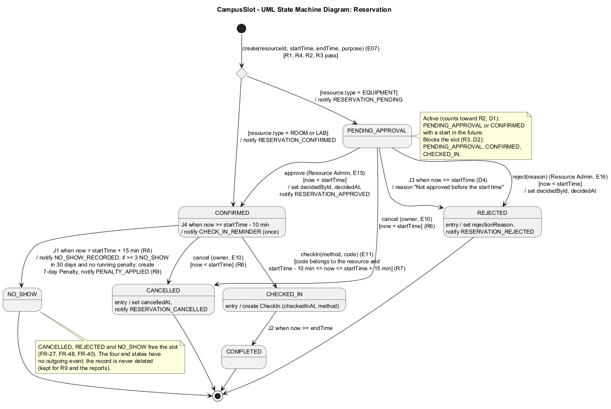

## 5.7 Software Design: State Machine Diagram (draft v1, 24 Nov 2026)

**Owner.** Enes (Frontend Developer). The sequence diagrams (Enes), the class diagram (Erol), the component and deployment diagrams (Batuhan) and the design patterns are separate parts of 5.7.

### 5.7.x UML State Machine Diagram: Reservation

Diagram: `docs/diagrams/5.7_state-machine-diagram_Enes.puml` (PNG: `5.7_state-machine-diagram_Enes.png`, rendered on 24 Nov 2026 with PlantUML 1.2026.10: `java -jar plantuml.jar -Playout=smetana -tpng <file>.puml`).

A reservation is the only object in CampusSlot whose behaviour depends on its state: the same action (cancel, check in, approve) is allowed in one state and refused in another. The diagram shows the seven states of the project card and every event that moves a reservation from one state to another. The state names are the values of `enum ReservationStatus` in `backend/prisma/schema.prisma`, so the diagram, the database and the API use the same words. On the server the allowed transitions are kept in one place, `ReservationStateMachine` in the Domain layer (5.8.1); a request for a transition that the diagram does not show is answered with `409 INVALID_STATE_TRANSITION` (5.8.4.3).

**Notation.** A label on an arrow reads `event [guard] / action`. The event is what happens (a user request or a scheduler job), the guard is the condition that must be true at that moment, and the action is what the system does during the transition. `entry /` inside a state is an action that runs every time the state is entered. "When ..." events are time events checked by the System Scheduler every 60 seconds (5.8.4.9). The diamond is a choice point: the reservation goes one way or the other depending on the guard.

#### States

| State | Meaning | Active for R2 (D1) | Blocks the slot (R3, D2) | Final |
|---|---|---|---|---|
| `PENDING_APPROVAL` | An `EQUIPMENT` reservation waiting for the Resource Admin (R5). | Yes, while the start is in the future | Yes | No |
| `CONFIRMED` | The reservation holds the slot; the user must check in at the start (R7). | Yes, while the start is in the future | Yes | No |
| `CHECKED_IN` | The user checked in inside the window; the reservation is in use. | No | Yes | No |
| `COMPLETED` | The reservation was used and its end time has passed. | No | No | Yes |
| `CANCELLED` | The owner cancelled before the start (R6). | No | No | Yes |
| `NO_SHOW` | No check-in within 15 minutes after the start (R8). Counts toward the R9 penalty. | No | No | Yes |
| `REJECTED` | The Resource Admin rejected it, or nobody decided before the start (D4). | No | No | Yes |

#### Transitions

| # | From → To | Event (who) | Guard | Action | Source |
|---|---|---|---|---|---|
| T1 | start → `PENDING_APPROVAL` | `create` (Campus User, E07) | The rule chain passes (R1, R4, R2, R3) and `resource.type = EQUIPMENT` | Notification `RESERVATION_PENDING` | R5, FR-19, 5.8.4.7 |
| T2 | start → `CONFIRMED` | `create` (Campus User, E07) | The rule chain passes and `resource.type` is `ROOM` or `LAB` | Notification `RESERVATION_CONFIRMED` | R5, FR-18, 5.8.4.7 |
| T3 | `PENDING_APPROVAL` → `CONFIRMED` | `approve` (Resource Admin, E15) | `now < startTime` (otherwise `422 RESERVATION_ALREADY_STARTED`, 5.8.4.3) | Set `decidedById`, `decidedAt`; notification `RESERVATION_APPROVED` | FR-45, FR-47, FR-30 |
| T4 | `PENDING_APPROVAL` → `REJECTED` | `reject(reason)` (Resource Admin, E16) | `now < startTime` (otherwise `422 RESERVATION_ALREADY_STARTED`, 5.8.4.3) | Set `decidedById`, `decidedAt`, `rejectionReason`; notification `RESERVATION_REJECTED` | FR-46, FR-47 |
| T5 | `PENDING_APPROVAL` → `REJECTED` | J3 AutoRejectJob (System Scheduler) | `now ≥ startTime` | `rejectionReason` = "Not approved before the start time", `decidedById` = null; notification `RESERVATION_REJECTED` | D4, FR-55 |
| T6 | `PENDING_APPROVAL` → `CANCELLED` | `cancel` (owner, E10) | `now < startTime` | Set `cancelledAt`; notification `RESERVATION_CANCELLED` | R6, FR-25, FR-30 |
| T7 | `CONFIRMED` → `CANCELLED` | `cancel` (owner, E10) | `now < startTime` | Set `cancelledAt`; notification `RESERVATION_CANCELLED` | R6, FR-25, FR-30 |
| T8 | `CONFIRMED` → `CHECKED_IN` | `checkIn(method, code)` (Campus User, E11) | The QR token or 6-digit code belongs to the reservation's resource and `startTime − 10 min ≤ now ≤ startTime + 15 min` | Create `CheckIn` with `checkedInAt` and `method` | R7, FR-34, FR-35, 5.8.4.8 |
| T9 | `CONFIRMED` → `NO_SHOW` | J1 NoShowJob (System Scheduler) | `now > startTime + 15 min` | Notification `NO_SHOW_RECORDED`. If the user now has 3 or more `NO_SHOW` with a start in the last 30 days and no running penalty: create a 7-day `Penalty`, notification `PENALTY_APPLIED` | R8, R9, FR-39, FR-41, FR-42 |
| T10 | `CHECKED_IN` → `COMPLETED` | J2 CompleteJob (System Scheduler) | `now ≥ endTime` | — | FR-38 |
| — | `CONFIRMED` (no state change) | J4 ReminderJob (System Scheduler) | `startTime − 10 min ≤ now < startTime`, no reminder sent yet | Notification `CHECK_IN_REMINDER` | FR-30 |

**Why the check-in window and the no-show rule do not overlap.** T8 accepts a check-in up to and including `startTime + 15 min`; T9 fires only when `now > startTime + 15 min`. Both use the same boundary, so a reservation can never be both open for check-in and a no-show (5.8.4.8).

**Why there is no transition out of the end states.** `COMPLETED`, `CANCELLED`, `NO_SHOW` and `REJECTED` are final. A reservation is never deleted (5.8.4.1, state changes): the `NO_SHOW` records are needed to count R9, and all four are needed for the usage report (UC-08).

**What the rule chain refusal means for the diagram.** When a rule in E07 fails (for example `RULE_R3_OVERLAP`), no reservation is created, so there is no state and no arrow for it. These refusals are shown in the Make Reservation sequence diagram.

#### How the frontend uses the diagram

The frontend does not change states itself; it calls the endpoint for the event and shows the status the server returns. It uses the diagram only to decide what to offer:

- My Reservations shows the Cancel button only for `PENDING_APPROVAL` and `CONFIRMED` reservations whose start is in the future (T6, T7).
- A `PENDING_APPROVAL` reservation is shown with the message that it waits for approval (T1).
- The Approvals screen lists only `PENDING_APPROVAL` reservations (E14) and offers approve and reject (T3, T4).
- If the state changed in the meantime (for example the scheduler ran T9 while the page was open), the server answers `409 INVALID_STATE_TRANSITION` or a check-in error, and the page shows `error.message` and reloads the list.

#### Decided points

- **Approve or reject after the start time.** J3 runs every 60 seconds, so for up to about one minute after `startTime` a `PENDING_APPROVAL` reservation can still exist. E15 and E16 refuse it with `422 RESERVATION_ALREADY_STARTED` (5.8.4.3 catalogue, DP-3; H41), so T3 and T4 carry the guard `now < startTime` and only J3 (T5) moves such a reservation to `REJECTED`.

#### Open points

- **Deactivated resource with future reservations.** 5.4 leaves open what happens to them (cancel or keep). If they are cancelled by the system, the diagram needs one more transition to `CANCELLED`. [TBD: Product Owner]
- **Trigger of `COMPLETED`.** FR-38 marks the trigger (end time passed) as the PM's reading of the project card. [TBD: confirm, Zeynep]
- **Delay of time events.** Because the scheduler runs every 60 seconds, T5, T9 and T10 happen up to about one minute after their time, and later if the Render free instance was asleep (5.7 Deployment, risks).

### Notes on sources

- States: project card and `enum ReservationStatus` in `backend/prisma/schema.prisma`. Notification names: `enum NotificationType` in the same file.
- Events, guards and actions: 5.4 (R1–R9, D1–D4, FR-18 to FR-55), 5.8.4.7 (rule chain), 5.8.4.8 (check-in logic) and 5.8.4.9 (scheduler jobs J1–J4).
- `RESERVATION_APPROVED` on T3 and `RESERVATION_CANCELLED` on T6 and T7 come from FR-30 (list of notification events) and FR-47; the API design (E10, E15) does not name these notifications. [TBD: Erol, confirm]
- No external source was used.
