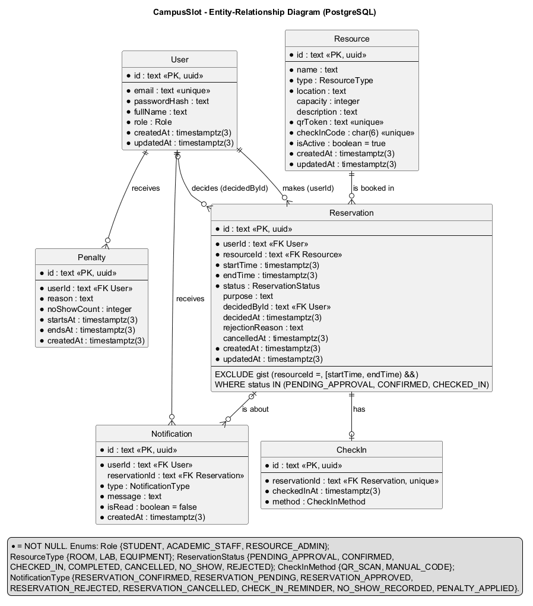

## 5.8.3 Data Model and Database Design (draft v1, 26 Nov 2026)

**Owner.** Erol (Backend Developer).
**Source of truth.** `backend/prisma/schema.prisma` and the two migrations in `backend/prisma/migrations` (`20261123120000_init`, `20261126120000_r3_overlap_guard`). Every table, field and constraint below is taken from these files. Entity and enum names are exactly those of the project card.

Diagram: `docs/diagrams/5.8_erd_Erol.puml` (PNG: `5.8_erd_Erol.png` [TBD: render with PlantUML, H47]).

### 5.8.3.1 Database choice and conventions

| Topic | Decision | Reason |
|---|---|---|
| DBMS | PostgreSQL 14 or newer (CI uses 16) | Relational data with foreign keys and transactions across Reservation, Penalty and Notification; exclusion constraints for R3 (5.8.2). |
| Access | Prisma ORM 7.10.1 with the `pg` driver adapter | Typed queries and parameterised SQL (no string concatenation, 5.8.5.2 A05); migrations under version control. |
| Primary keys | `text` holding a UUID (`@default(uuid())`) | Ids cannot be guessed by counting (5.8.4.1). |
| Time | `timestamptz(3)` (UTC in the database, millisecond precision) | All rules compare moments in time; the campus time zone `Europe/Istanbul` is applied only when a date is read or shown (5.8.4.1). |
| Names | Tables and columns as in the project card, camelCase columns | The API fields are the same names, so no mapping layer is needed (5.8.4.1). |
| Deletion | No hard delete in normal use: a resource is deactivated (`isActive = false`), a reservation changes status | Cancelled, rejected and no-show reservations are needed for R9 and for the reports (UC-08). |

### 5.8.3.2 Tables

**User**: a person who logs in.

| Column | Type | Null | Constraint / default | Meaning |
|---|---|---|---|---|
| id | text | no | PK, UUID | |
| email | text | no | unique | Login name, stored in lower case (FR-03) |
| passwordHash | text | no | | bcrypt hash, cost 10; never the plain password (NFR-01) |
| fullName | text | no | | |
| role | Role | no | | `STUDENT`, `ACADEMIC_STAFF` or `RESOURCE_ADMIN` |
| createdAt, updatedAt | timestamptz(3) | no | set by Prisma | |

**Resource**: a room, lab or piece of equipment.

| Column | Type | Null | Constraint / default | Meaning |
|---|---|---|---|---|
| id | text | no | PK, UUID | |
| name | text | no | | |
| type | ResourceType | no | | `ROOM`, `LAB` or `EQUIPMENT`; decides R5. Cannot be changed through the API (E19). |
| location | text | no | | |
| capacity | integer | yes | | Number of people; required for ROOM and LAB, `null` for EQUIPMENT (checked by the API, E18/E19) |
| description | text | yes | | |
| qrToken | text | no | unique | Value encoded in the door QR code; 24 random bytes from `crypto.randomBytes` (5.8.5.2 A04) |
| checkInCode | char(6) | no | unique | 6-digit fallback code under the QR code; `crypto.randomInt` |
| isActive | boolean | no | default `true` | `false` = deactivated; not listed and not bookable (FR-11) |
| createdAt, updatedAt | timestamptz(3) | no | set by Prisma | |

**Reservation**: a booking of one resource for one time range.

| Column | Type | Null | Constraint / default | Meaning |
|---|---|---|---|---|
| id | text | no | PK, UUID | |
| userId | text | no | FK → User.id, `ON DELETE RESTRICT` | Owner |
| resourceId | text | no | FK → Resource.id, `ON DELETE RESTRICT` | |
| startTime, endTime | timestamptz(3) | no | | Half-open range [start, end) |
| status | ReservationStatus | no | | One of the 7 statuses; changed only through the state machine (5.7) |
| purpose | text | yes | | Max 200 characters (API) |
| decidedById | text | yes | FK → User.id, `ON DELETE SET NULL` | Resource Admin who approved or rejected (R5); `null` for automatic rejection (D4) |
| decidedAt | timestamptz(3) | yes | | Time of the decision |
| rejectionReason | text | yes | | Admin's reason, or "Not approved before the start time" (J3) |
| cancelledAt | timestamptz(3) | yes | | Time of the cancellation (R6) |
| createdAt, updatedAt | timestamptz(3) | no | set by Prisma | |

**CheckIn**: proof that the owner was at the door (R7).

| Column | Type | Null | Constraint / default | Meaning |
|---|---|---|---|---|
| id | text | no | PK, UUID | |
| reservationId | text | no | FK → Reservation.id, **unique**, `ON DELETE CASCADE` | At most one check-in per reservation (FR-36, NFR-09) |
| checkedInAt | timestamptz(3) | no | | Server time of the check-in (set by the API from the server clock, NFR-10) |
| method | CheckInMethod | no | | `QR_SCAN` or `MANUAL_CODE` (typed 6-digit code) |

**Penalty**: a reservation ban (R9).

| Column | Type | Null | Constraint / default | Meaning |
|---|---|---|---|---|
| id | text | no | PK, UUID | |
| userId | text | no | FK → User.id, `ON DELETE CASCADE` | |
| reason | text | no | | For example "3 NO_SHOW in last 30 days" |
| noShowCount | integer | no | | No-shows in the 30-day window when the penalty was created |
| startsAt, endsAt | timestamptz(3) | no | | `endsAt = startsAt + 7 days`; running when `startsAt ≤ now < endsAt` (R4) |
| createdAt | timestamptz(3) | no | default now | |

**Notification**: an in-app message (F4).

| Column | Type | Null | Constraint / default | Meaning |
|---|---|---|---|---|
| id | text | no | PK, UUID | |
| userId | text | no | FK → User.id, `ON DELETE CASCADE` | Receiver |
| reservationId | text | yes | FK → Reservation.id, `ON DELETE SET NULL` | Related reservation; `null` for `PENALTY_APPLIED` |
| type | NotificationType | no | | See 5.8.3.4 |
| message | text | no | | English sentence shown to the user |
| isRead | boolean | no | default `false` | Set by E13 |
| createdAt | timestamptz(3) | no | default now | |

### 5.8.3.3 Relationships

| From | To | Cardinality | Foreign key | On delete | Reason for the delete rule |
|---|---|---|---|---|---|
| User | Reservation (as owner) | 1 : 0..* | Reservation.userId | RESTRICT | A user with reservations is not deleted; the history is needed for R9 and the reports. |
| User | Reservation (as decider) | 0..1 : 0..* | Reservation.decidedById | SET NULL | The decision stays even if the admin account is removed. |
| Resource | Reservation | 1 : 0..* | Reservation.resourceId | RESTRICT | A resource is deactivated, not deleted (E19). |
| Reservation | CheckIn | 1 : 0..1 | CheckIn.reservationId (unique) | CASCADE | A check-in has no meaning without its reservation. |
| User | Penalty | 1 : 0..* | Penalty.userId | CASCADE | Penalties belong to the user. |
| User | Notification | 1 : 0..* | Notification.userId | CASCADE | Notifications belong to the user. |
| Reservation | Notification | 0..1 : 0..* | Notification.reservationId | SET NULL | The message stays readable. |

### 5.8.3.4 Enumerations

| Enum | Values | Source |
|---|---|---|
| Role | STUDENT, ACADEMIC_STAFF, RESOURCE_ADMIN | Project card |
| ResourceType | ROOM, LAB, EQUIPMENT | Project card |
| ReservationStatus | PENDING_APPROVAL, CONFIRMED, CHECKED_IN, COMPLETED, CANCELLED, NO_SHOW, REJECTED | Project card |
| CheckInMethod | QR_SCAN, MANUAL_CODE | Project card ("QR code or 6-digit code") |
| NotificationType | RESERVATION_CONFIRMED, RESERVATION_PENDING, RESERVATION_APPROVED, RESERVATION_REJECTED, RESERVATION_CANCELLED, CHECK_IN_REMINDER, NO_SHOW_RECORDED, PENALTY_APPLIED | Proposed by the Backend Developer (DM-A1) |

### 5.8.3.5 Constraints that protect the business rules

| Constraint | Kind | Protects | Error in the API |
|---|---|---|---|
| `User_email_key` | unique index | FR-03: one account per e-mail | `409 EMAIL_TAKEN` |
| `Resource_qrToken_key`, `Resource_checkInCode_key` | unique indexes | FR-31, NFR-09: a door code identifies exactly one resource | (server generates a new code and retries) |
| `CheckIn_reservationId_key` | unique index | FR-36, NFR-09: one check-in per reservation | `409 ALREADY_CHECKED_IN` |
| `Reservation_r3_no_overlap_excl` | exclusion constraint `EXCLUDE USING gist ("resourceId" WITH =, tstzrange("startTime","endTime",'[)') WITH &&) WHERE status IN ('PENDING_APPROVAL','CONFIRMED','CHECKED_IN')`, extension `btree_gist` | R3, D2, NFR-08: two parallel requests cannot both book an overlapping slot. Back-to-back slots are allowed (`[)` range). `NO_SHOW`, `CANCELLED`, `REJECTED`, `COMPLETED` free the slot (R8). | `409 RULE_R3_OVERLAP` (PostgreSQL SQLSTATE 23P01) |

The other rules (R1, R2, R4–R9) depend on the current time or on the user's history, so they are checked in the Domain layer with the server time (5.8.1, 5.8.4.7). R3 is checked in both places: the `OverlapRule` gives a clear error in the normal case, and the exclusion constraint catches the rare parallel case.

### 5.8.3.6 Indexes and the queries they serve

| Index | Columns | Query |
|---|---|---|
| `Reservation_resourceId_startTime_endTime_idx` | resourceId, startTime, endTime | R3 overlap check (E07), availability calendar (E06) |
| `Reservation_userId_status_startTime_idx` | userId, status, startTime | R2 active count (D1), My Reservations (E08), R9 no-show count |
| `Reservation_status_startTime_idx` | status, startTime | Scheduler jobs J1, J3, J4; reports (E20) |
| `Penalty_userId_endsAt_idx` | userId, endsAt | R4 running penalty (E07, E03) |
| `Notification_userId_isRead_createdAt_idx` | userId, isRead, createdAt | Notification list and unread count (E12) |
| `Resource_type_isActive_idx` | type, isActive | Resource search and filter (E04) |
| GiST index of `Reservation_r3_no_overlap_excl` | resourceId, time range | Created by the exclusion constraint |

### 5.8.3.7 Normalisation

Every non-key column depends on the whole primary key and on nothing else, so the tables are in third normal form (3NF). Two choices are deliberate:
- `Penalty.noShowCount` stores the count at the moment the penalty was created. It could be computed again from Reservation, but the count changes later (old no-shows leave the 30-day window), and the admin report (E22) must show why the penalty was given.
- Derived values (active reservation count, occupancy rate, no-show rate) are **not** stored. They are computed from Reservation when they are needed, so they can never be out of date.

### 5.8.3.8 Migrations and seed data

| Migration | Content |
|---|---|
| `20261123120000_init` | All tables, enums, indexes and foreign keys; generated from the schema with `prisma migrate diff`. |
| `20261126120000_r3_overlap_guard` | `btree_gist` extension and the R3 exclusion constraint; written by hand because Prisma schema syntax cannot express it (H02). |

`npm run db:seed` (`backend/prisma/seed.ts`) fills a development or demo database: 7 users (1 Resource Admin, 2 Academic Staff, 4 Students, all with fictional names, SEC-A3), 13 resources (5 ROOM, 4 LAB, 4 EQUIPMENT; door codes 100001–100013) and reservations in all 7 statuses, including one user with 3 no-shows and a running penalty. Times are relative to the moment the seed runs.

### 5.8.3.9 Assumptions

| ID | Assumption |
|---|---|
| DM-A1 | The project card does not list notification kinds. The eight `NotificationType` values are proposed by the Backend Developer to cover FR-28 to FR-30 and J1–J4. |
| DM-A2 | A `PENDING_APPROVAL` reservation blocks its slot (same as D2 in 5.4); the exclusion constraint therefore includes this status. |
| DM-A3 | Users and resources are not hard-deleted in normal use (no endpoint deletes them). The delete rules in 5.8.3.3 only matter for maintenance by a database administrator. |

### 5.8.3.10 Sources

- Project files: `backend/prisma/schema.prisma`, `backend/prisma/migrations/*`, `backend/prisma/seed.ts`; 5.4 (D1–D4), 5.8.4 (API contract), 5.8.5 (security).
- PostgreSQL exclusion constraints and `btree_gist`: PostgreSQL documentation, "CREATE TABLE … EXCLUDE" and "btree_gist" [TBD: Arzum, add the exact documentation pages to 5.15 if the team cites them].
